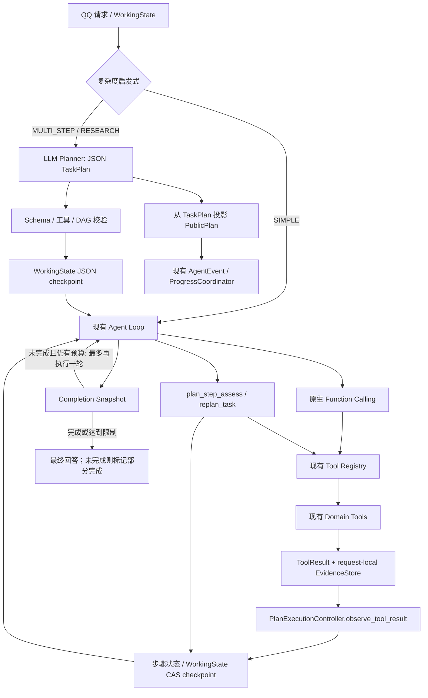

# Agent Planning V1 实施报告

## 1. 交付摘要

**IMPLEMENTED**：保留现有 `run_agent_loop()`、Tool Registry、Context V2、EvidenceStore、WorkingState、Compaction 和 Progress V2，新增复杂度门控、结构化任务计划、证据约束的步骤评估、最多两次动态重规划，以及最终完成检查。简单请求仍直接走原来的 Agent 路径；复杂请求在正常 Agent 执行前增加一次受预算与 deadline 约束的 Planner 调用。

**TESTED_WITH_FAKE / TESTED_LOCALLY**：新增规划测试 20 项；最终完整 unittest discovery 为 **509 项通过、0 项失败**。固定 Fake Fixture 展示了计划状态、无结果重规划和旧路径对照。没有调用真实模型、QQ 或付费 API，也没有真实 GTNH 数据或 SFM Parser 验证。

步骤完成状态由模型基于执行观察提出，程序检查调用 ID、Evidence 作用域、工具状态、Evidence 类型/完整度和依赖。自然语言完成条件仍是模型评估，状态会记录为 `model_assessed`；这不是独立的客观语义证明。

## 2. 架构变化



没有第二个工具执行器、Agent Loop、Tool Registry 或任务数据库。Planner 不执行工具。所有业务工具仍由现有 Registry 做权限、参数、deadline、并发和结果处理。

## 3. 复杂度判断与 Planner

新增 `app/planning/planner.py`：

- `assess_task_complexity()` 用确定性中文/英文动词类别和研究词汇判断；至少命中三个动作类别才启用多步骤规划，研究词汇且至少三个动作类别归为 `RESEARCH`。
- `SIMPLE` 不调用 Planner；`MULTI_STEP` 和 `RESEARCH` 复用当前 LLM Client 的 `chat()` 生成 JSON。
- Planner 仅在剩余 deadline 不少于 4 秒且存在 `chat()` 接口时启动。该请求有最大 1800 输出 Token 提示值，并由已有 LLM Client 执行 Context Window / Usage Budget 控制；实际仍受总请求 deadline 限制。
- JSON 解析或 Schema 校验失败时记录类型化日志并降级到现有 Agent Loop，不把错误计划用于执行。
- 未采用独立 API Key、未新增模型通道或依赖。Planner 是额外一次模型请求，预算不足时会受现有调用预算约束。

复杂度判断是轻量启发式，不是语义分类器，可能漏掉表达隐晦的多步骤请求或误触发规划。不会为了分类额外调用一次模型。

## 4. TaskPlan、状态及持久化

新增 `app/planning/contracts.py`：

- `TaskComplexity`：`simple`、`multi_step`、`research`。
- `PlanStep`：ID、描述、依赖、可观察完成条件、必需 Evidence 类型、允许工具名、状态、模型评估、Evidence 引用、Tool Call ID 和验证类型。
- `TaskPlan`：固定 `task_id`、原始目标、原始约束、最多 8 步、revision 和最多 2 次 replan。
- 计划验证会拒绝重复 ID、未知依赖、循环依赖、超长字段、超过 8 步、未知/未启用工具及不支持的 Evidence 类别。
- Planner 输出只有 `steps` 字段；目标和约束由程序提供，不接受模型覆盖。

`app/context/contracts.py` 将可选 `TaskPlan` 放入现有 `WorkingState`；`app/context/working.py` 通过原有 `state_json` 与 revision/CAS checkpoint 持久化，不增加 SQL 表或迁移。旧 WorkingState 没有 `task_plan` 时仍可加载；如果字段存在但计划损坏则拒绝该记录，不静默降级成无计划状态。

`_working_state_prompt_data()` 将当前 TaskPlan 作为有界、不可信的运行数据交给 Compactor，Compaction 后每轮仍可见。计划数据不作为证据或权限来源。

## 5. Plan-Aware 执行与重规划

新增 `app/planning/controller.py::PlanExecutionController`，是 request-local 计划状态归约器：

1. 实际工具返回后，使用 Tool Call ID、工具名、状态和 EvidenceStore 引用记录观察。
2. 成功/部分成功仅将适配步骤设为 `IN_PROGRESS`；失败或无结果设为 `BLOCKED`。Registry 执行成功本身不会完成步骤。
3. 隐藏内部 Tool Registry 工具 `plan_step_assess` 接收当前模型响应中的评估。程序确认 Call ID 和 Evidence 引用属于本请求、引用仍在 EvidenceStore 中、工具状态可用、Evidence 类型/完整度匹配，以及依赖步骤已完成，才接受 `SATISFIED`。
4. 对自然语言完成条件的模型判断明确记为 `model_assessed`。纯语义内容仍不能被确定性代码完全验证。
5. 工具名不能唯一定位计划步骤时不自动分配，要求模型通过实际 Call ID 和 Evidence 做明确关联。
6. 同一模型响应可对不同步骤使用相同可见 revision 批量评估；同一响应不能对同一步提交互相矛盾的重复评估。
7. 隐藏内部 Registry 工具 `replan_task` 最多成功两次。程序保留固定目标和约束、精确保留已完成步骤，并拒绝删除未完成步骤、修改其完成条件或降低 Evidence 要求。只有仍有启用工具的计划可被应用。

执行控制保持开放：Agent 仍可调用计划之外但 Registry 已授权的辅助工具；计划用于指导和验收，不是新权限表或硬编码流水线。所有模型和工具请求共享既有请求 deadline、Usage Budget、Tool 调用上限和 Context Window Budget。

## 6. 完成检查与 QQ PublicPlan

`run_agent_loop()` 每轮调用前把 TaskPlan 放入 WorkingState prompt；工具调用处理之后更新步骤并 checkpoint。模型返回最终文本但计划仍未完成时，Agent 最多再获得一轮执行机会；最终仍未完成时，回复前会添加“任务未完全完成”及未完成步骤计数，提示只报告部分结果。计划完成快照会复查依赖、SATISFIED 状态、请求内 ToolResult 和 Evidence 仍然有效。

QQ PublicPlan 由验证后的 `TaskPlan.public_summary()` 生成，发送仍经过现有 `AgentEvent`、`ProgressCoordinator` 和 Reporter。计划步骤的状态事件由 Controller 发出。没有重写进度投递路径，也没有把计划写成工具事实；简单请求不生成 PublicPlan。未修改隐藏推理处理，也未读取 `reasoning_content`。

## 7. Fixture 与 V1/V2 对照

新增 [tests/test_agent_planning.py](../tests/test_agent_planning.py)，覆盖：

- 简单请求、复杂度分类、非法 JSON、超出步数、循环依赖和未知工具。
- WorkingState checkpoint round-trip、旧存储格式兼容路径、已损坏计划拒绝。
- 成功 Tool 不自动完成步骤、Evidence 作用域和类型检查、依赖、同轮并发评估、重复评估拒绝。
- 重规划保留目标、约束、已完成步骤和未解决条件，最多两次。
- 北京天气→计算→新闻搜索→正文读取→故事的 Fake 成功场景。
- 新闻无结果→有限重规划→明确部分完成，不能编造来源。
- GTNH Wiki/结构化配方/SFM Parser 计划要求 Fixture。
- 简单请求 Planner 调用数为 0。

固定成功 Fixture 的一次 A/B 运行：

| 指标 | 原 Agent Loop Fixture | Planning V1 Fixture |
|---|---:|---:|
| Fake 模型请求 | 4 | 6（1 Planner + 5 Agent 请求） |
| 业务工具调用 | 3 | 3 |
| 内部计划评估调用 | 0 | 5 |
| 计划步骤状态 | 没有结构化计划，无法度量 | 5/5 已标记完成 |
| Replan | 无计划能力 | 0 |
| 累计输入消息 UTF-8 字节 | 5,573 | 30,918 |
| 本次本地 Fake 运行耗时 | 约 8.08 ms | 约 14.26 ms |

这些值来自一次本地 Fake 执行；输入字节不是 Token 数，时间受本机和临时 SQLite 影响。两条路径的 Fake 对话本身按脚本返回成功，因此不能由此推断真实模型的完成率、约束保持率或质量提升。V2 能提供明确的结构化状态，V1 路径没有同等完成状态指标。

GTNH Fixture 只验证计划包含版本边界、来源、结构化配方和真实 Validator 要求；当前没有 GTNH 文档/配方数据。本次未运行真实 SFM Parser；Fake 计划不等于真实验证通过。

## 8. 测试结果

**最终全量命令：**

```bash
timeout 300 .venv/bin/python -m unittest discover -s tests -q
```

结果：**509 tests passed，0 failures，0 errors**，约 11.5 秒。输出中包括现有测试的模拟错误日志、FastAPI deprecation warnings 和 SQLite `ResourceWarning`；全量测试进程以成功结果结束。

规划定向命令：

```bash
timeout 120 .venv/bin/python -m unittest tests.test_agent_planning -q
```

结果：20 项通过。

实施中运行过 Agent、Compaction、Context、Progress、Tool Registry 和 Working Memory 定向回归，共 128 项通过。`.venv/bin/ruff` 不存在，因此本次未运行 Ruff；没有新增依赖。

## 9. 修改文件

- 新增 `app/planning/__init__.py`、`contracts.py`、`planner.py`、`controller.py`。
- 修改 `app/context/contracts.py`、`app/context/working.py`、`app/tools/agent.py`、`app/handlers/llm_handler.py`、`app/progress/events.py`。
- 新增 `tests/test_agent_planning.py`。
- 新增 `docs/AGENT_PLANNING_PROGRESS.md`。

无数据库 Schema 迁移、无外部依赖变化、无生产数据写入、无部署或 Git push。

## 10. 剩余风险与能力状态

- **IMPLEMENTED**：轻量复杂度门控、计划 JSON 校验、WorkingState checkpoint、Agent Loop 接线、工具观察、依赖/Evidence 检查、有限重规划、部分完成保护、PublicPlan 与计划事件。
- **TESTED_WITH_FAKE**：天气/新闻故事成功与新闻无结果场景、GTNH/SFM 计划边界、并行工具评估、Evidence 作用域和持久化。
- **TESTED_LOCALLY**：509 项完整 unittest；本地 Fake A/B 请求与调用开销。
- **NOT_VERIFIED**：真实模型 JSON 服从率、复杂任务完成质量、真实 token/费用增量、真实 GTNH 数据和真实 SFM Parser。没有生产环境验证。
- **BLOCKED**：没有本地外部阻塞；真实领域能力仍需要未来取得并审核相应数据或 Parser。

主要设计限制是自然语言完成条件仍由模型评估；程序校验的是来源、调用、状态、依赖和 Evidence 结构，不是通用语义证明。启发式分类也可能漏判复杂任务。Planner 失败时会回退原 Agent，因此不保证所有复杂请求都具有显式计划。

**本地可部署状态**：代码和自动化测试可供审查，但没有在真实模型、QQ 群或生产环境验证；本次未部署。
