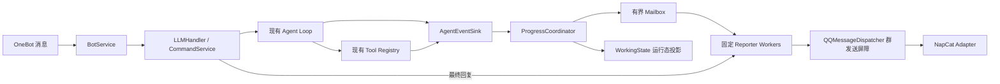

# Agent Progress V1 实施报告

## 1. 交付状态

AP-01～AP-08 已在当前工作区完成。本轮将执行事件、工具真实生命周期、请求级进度聚合和 QQ 投递接入现有 Agent Loop、Tool Registry、WorkingState 与 QQMessageDispatcher；没有新建 Agent Loop、工具注册表、任务数据库或数据库迁移。

验证级别：

- **IMPLEMENTED**：事件契约、Registry/Agent 事件、Coordinator、Reporter、命令、静态文案均已接线。
- **TESTED_WITH_FAKE**：Fake LLM、Fake Tool/Clock、Fake QQ Adapter、临时/既有测试库覆盖了进度生命周期与错误路径。
- **TESTED_LOCALLY**：完整本地 unittest、`compileall`、`git diff --check` 通过。
- **NOT_VERIFIED**：真实 NapCat/QQ 消息展示和跨网络送达顺序、生产并发负载、真实模型体验。
- **BLOCKED**：无本地代码阻塞；现场 NapCat 验证需要部署环境，按要求本次未进行。

没有调用真实模型、Tavily、QQ/NapCat 或生产数据库；没有部署、提交或 push。

## 2. 实际架构



事件是进程内同步、类型化观察信号，不进入 LLM messages，也不写入第二套持久化事件表。Agent/命令执行仍由原请求协程负责。只有状态文本由固定的 Reporter worker 异步投递。

### 关键实现

- `TaskIdentity` 含独立 UUID `task_id`、源 `request_id`、group/user、epoch 和 origin；事件有 schema version、单请求 sequence、UTC 时间和有界 payload。[events.py](../app/progress/events.py#L109) [events.py](../app/progress/events.py#L149)
- `RequestAgentEventSink` 按请求发号，限制非终态事件数，并隔离 observer 异常。[events.py](../app/progress/events.py#L191)
- `ToolContext` 携带 identity、sink、tool_call_id 和轮次，Agent Loop 将这些信息传给统一 Registry。[contracts.py](../app/tools/contracts.py#L108) [agent.py](../app/tools/agent.py#L497)
- BotService 在普通消息/斜杠命令进入实际处理时注册任务、读取群模式并发出唯一终态；task_id 同时传到 ContextManager/WorkingState。[bot_service.py](../app/bot_service.py#L101) [bot_service.py](../app/bot_service.py#L168)
- Main lifespan 启动两个固定 Reporter worker 和 Coordinator 的单一 scheduler；shutdown 先停消息 Runtime，再收 Reporter、Coordinator 和依赖。[main.py](../app/main.py#L278) [main.py](../app/main.py#L298)

## 3. 工具与 Agent 事件语义

`ToolRegistry.dispatch()` 是工具生命周期权威入口：未知工具、权限拒绝、参数错误、过期 deadline 在 started 前产生 `TOOL_REJECTED`；先通过参数校验、deadline 与 Semaphore，再发 `TOOL_STARTED`；成功结果经输出/Evidence 限制后再根据真实 `ToolStatus` 发完成或失败事件。事件只包含静态类别、状态、执行标志、保留 Evidence 数和完整性，不包含参数、正文或异常文本。[registry.py](../app/tools/registry.py#L223) [registry.py](../app/tools/registry.py#L281) [registry.py](../app/tools/registry.py#L353)

Agent Loop 发出模型请求、Compaction、checkpoint 以及任务内跳过/拒绝相关事件；checkpoint 只有 WorkingState 持久化成功后才报 `CHECKPOINT_SAVED`。Compaction 复用既有 fitter，不改变其选择与协议逻辑。[agent.py](../app/tools/agent.py#L553) [agent.py](../app/tools/agent.py#L610) [agent.py](../app/tools/agent.py#L642)

普通 Agent tool calls 仍然并发执行。Registry 事件按实际完成先后到达，使用 `tool_call_id` 聚合；Agent 原有的模型协议结果仍按调用序回填。被拒绝或因 Semaphore 等待取消的调用不会伪报为已开始。

## 4. ProgressCoordinator 与资源上限

Coordinator 使用同步 reducer，按 task identity、sequence、tool_call_id 处理真实事件；可按用户/群权限读取只读快照。启动一个 scheduler 主动唤醒首次进度 deadline，避免“事件检查时还不到 3 秒、之后直到工具结束才发状态”的竞态。[coordinator.py](../app/progress/coordinator.py#L179) [coordinator.py](../app/progress/coordinator.py#L299) [coordinator.py](../app/progress/coordinator.py#L351)

| 限制 | 实际值 |
|---|---:|
| 首次有意义状态 | 3 秒 |
| 单任务最小进度间隔 | 8 秒 |
| 单任务中间状态上限 | 3 条 |
| 单任务事件上限 | 192 条；终态仍可入账 |
| 活跃任务 | 32 个 |
| 待发送 mailbox | 32 个 task 候选，每 task 合并为最新候选 |
| 候选时效 | 2 秒，过期丢弃 |
| Reporter 后台 worker | 固定 2 个 |
| 群级进度发送限制 | 跨 task 8 秒一次 |
| 全局进度发送限制 | 30 次/60 秒 |
| 单条状态长度 | 240 字符 |
| 终态快照保留 | 最多 256 条，且清理期限 15 分钟 |
| epoch/group 运行态追踪 | 有界 512 个群 |

`quiet` 不发布状态；`balanced` 默认；`verbose` 只展示静态类别与状态数量，不扩大消息配额。工具状态有 `SUCCESS / PARTIAL / NO_RESULTS / UNAVAILABLE / DENIED / TIMEOUT / ERROR / CANCELLED / REJECTED / UNKNOWN`，不把无结果或被拒绝合并为成功。

## 5. QQ 顺序、Reset/Purge 与终态

`QQMessageDispatcher.delivery_barrier(group_id)` 是群内所有普通 send、进度、Final 与 reset/purge 共用的锁；`send_locked()` 只能在调用方持有锁时使用。[qq_dispatcher.py](../app/qq_dispatcher.py#L64) [qq_dispatcher.py](../app/qq_dispatcher.py#L84)

Reporter 发送进度前，在群锁内重查候选时效、task terminal、sequence、协调器 epoch 和 SQLite epoch，再调用既有 Adapter。Final 先同步关闭该 task 的进度门，再等待同一群锁，所以已排队但尚未发送的进度会在取锁后失效；Final 也会在锁内复核 epoch。[reporter.py](../app/progress/reporter.py#L81) [reporter.py](../app/progress/reporter.py#L130)

Context Reset/Purge 在相同群屏障内建立内存 fence，检查确认时的 epoch，修改 SQLite epoch，再使旧任务变为 STALE；不会等待 Agent 协程。锁序固定为“群发送屏障 → 存储/Coordinator”，无路径在持有群锁时等待 Agent 或 Reporter。[service.py](../app/commands/service.py#L791) [service.py](../app/commands/service.py#L819)

保证边界：同一进程内，已经进入 Adapter 调用的状态消息会先于后续 Final/Reset 操作完成；尚未开始的过期状态会被丢弃。无法保证 QQ 服务端或客户端的远端展示顺序，也无法撤回已经发出的消息；NapCat Adapter 接受请求不等于用户已看到。

三类状态分别保留：

1. **Agent 执行终态**：Coordinator 收到 Agent terminal event，例如 `COMPLETED`、`FAILED`、`CANCELLED`、`TIMED_OUT` 或 `STALE`。
2. **WorkingState 状态**：`SAVED`、`FAILED`、`NOT_CONFIGURED` 或 `UNKNOWN`，checkpoint revision 仅在成功写入后记录。
3. **QQ Final 投递状态**：`accepted_by_adapter`、`suppressed`、`stale_epoch`、`failed` 或 `cancelled`。`accepted_by_adapter` 不是“已展示”。

进度丢弃、过期、限流、Dispatcher 抑制、Adapter 失败、Final 失败各有独立诊断计数。状态失败不会改写 Agent 执行结果。Main 仅在 final 被 Adapter 接受后继续安排摘要更新。[reporter.py](../app/progress/reporter.py#L23) [main.py](../app/main.py#L417)

## 6. 用户命令与模型调用

沿用既有 Command Registry 与群设置表，无迁移：

- `/config show`：显示本群进度模式。
- `/config set progress_mode quiet`
- `/config set progress_mode balanced`
- `/config set progress_mode verbose`
- `/agent status`：普通成员只查看本人活动任务；管理员仅查看本群活动数量和工具聚合数，不显示别人的任务目标、Query、用户 ID 或 Evidence。

默认 `balanced`。模式修改沿用命令层管理员权限。`/task` 继续代表 Scheduled Task，没有引入 Agent Cancel，也没有把任务记录当作存活协程。[service.py](../app/commands/service.py#L51) [service.py](../app/commands/service.py#L154) [service.py](../app/commands/service.py#L761) [service.py](../app/commands/service.py#L855)

V1 阶段文案由 `ToolCategory`、真实执行状态和安全计数的固定模板生成。模型专属等待显示“正在生成回复”，工具尚无结果时不会说“已完成工具处理”。公共计划只保留未来扩展边界：当前不读普通模型 content 或 reasoning，不增加模型请求。工具 Query、完整 URL、凭据、文件路径、异常和网页正文均不进入进度消息。[presentation.py](../app/progress/presentation.py#L35)

## 7. 测试结果

### 最终命令

```text
timeout 300 .venv/bin/python -m unittest discover -s tests -q
Ran 483 tests in 12.013s
OK
```

定向进度集：

```text
timeout 60 .venv/bin/python -m unittest tests.test_progress_coordinator tests.test_progress_reporter tests.test_agent_progress_integration -q
Ran 26 tests
OK
```

其他检查：涉及模块和测试的 `compileall` 成功；`git diff --check` 成功。当前环境没有安装 Ruff，未运行该工具。全量测试有预期故障注入日志、FastAPI `on_event` deprecation warning、外部 HTML 清理的正则参数 warning，以及少量既有 SQLite ResourceWarning；测试整体无失败。

### 验收场景覆盖概览

以下为 Fake/Fixture 或现有本地测试，不代表真实 QQ、真实模型、真实 GTNH 数据或真实 Parser 验证。

| 场景 | 测试证据 |
|---|---|
| 快速完成、2 秒任务与 10 秒单工具 | Coordinator 虚拟时钟测试：阈值前完成不补发；2 秒零状态；10 秒单工具最多一条 |
| 主动 3 秒唤醒、30 秒多阶段 | Coordinator 虚拟时钟与多阶段 notice 上限测试 |
| Agent → Registry → Reporter → Final | 新增 `test_agent_progress_integration`：Fake LLM/真实 Loop+Registry/Fake Clock/Fake QQ；顺序正确且无进度专属模型调用 |
| 5 个并发工具、乱序、结果分类 | Coordinator tool_call_id 聚合与 status matrix 测试；Registry 真实状态映射测试 |
| 被拒绝、timeout、deadline、cancel | Registry 未 started 拒绝/排队取消/timeout 测试；Agent total deadline 与外部取消测试 |
| pending 进度、Final 和 Reset/Purge 交错 | Reporter barrier/fence 测试；Command 确认 Reset/Purge 测试 |
| 多群/跨用户隔离、全局和群速率 | Coordinator group/user scope 测试；Reporter global/group rate cap 测试；命令权限/群隔离测试 |
| 投递失败、Dispatcher 抑制与 shutdown | Fake Adapter 故障、suppression、固定 worker shutdown 测试 |
| 恶意 query / CQ / 凭据样式 | 类型化事件不含自由参数；静态 Renderer 使用安全映射的恶意类别测试；原 Web Security 测试仍在全量套件内 |
| WorkingState 与 Agent/QQ 状态差异 | 独立诊断状态测试、Final Adapter 失败测试 |
| Tavily/GTNH/SFM 不可用 | 既有 Web Research 未配置、知识空索引/SFM unavailable 测试；不访问真实数据 |
| 完整 Bot 回归 | 483 项 unittest discovery 全部通过 |

本地集成仅覆盖 Fake Agent/Registry/Coordinator/Reporter 与 Fake QQ Adapter，不是启动真实 NapCat 的网络端到端。测试不证明远端投递成功。

## 8. 文件与迁移

主要新增：`app/progress/{events,coordinator,presentation,reporter}.py`，进度 contract、Coordinator、Reporter 与 Agent/Registry/QQ 集成测试，以及 `docs/AGENT_PROGRESS_IMPLEMENTATION_PROGRESS.md`。修改 Agent、Registry、ToolContext、BotService、LLMHandler、ContextManager、CommandService、QQ Dispatcher、Main 和对应测试。完整文件清单以当前 `git status --short` 为准；工作区原本包含 Context V2 与 Web Research/Tavily 的未提交工作，本轮没有提交或重置它们。

无数据库 schema 变更、迁移或历史数据操作。进度状态仅保存在本进程内；服务重启后不恢复运行中的 Agent，也不显示伪造的 active task。群配置复用现有 `group_settings`。

## 9. 剩余风险与部署边界

- **现场未验证**：NapCat 是否接受并展示多次 HTTP 上报、客户端展示顺序、实际速率限制和关机期间的远端处理。本地 Fake Adapter 不能证明这些行为。
- **进程边界**：事件、Coordinator 和 epoch 临时缓存是单进程状态，不支持多 worker 间共享或重启恢复；部署必须维持单进程假设，或未来另行设计协调机制。
- **锁与网络调用**：同群 Adapter 调用持有群级发送屏障，依赖现有 HTTP timeout 有界；远端阻塞期间同群其它 outbound 会等待。
- **生产配置**：默认 balanced 会产生少量中间消息。建议部署后先在受控群验证，管理员可通过 `/config set progress_mode quiet` 关闭播报；本次没有更改生产配置。
- **工具覆盖**：进度类别来自静态 ToolSpec 分类；新增工具需明确指定安全类别，否则使用通用提示。

## 10. 关键源码索引

- 事件类型、身份、payload 上限与 request sink：[`app/progress/events.py`](../app/progress/events.py#L19)
- 有界队列、主动 timer、去重、epoch 和运行快照：[`app/progress/coordinator.py`](../app/progress/coordinator.py#L179)
- 群锁内 epoch 检查、Final gate 与投递分类：[`app/progress/reporter.py`](../app/progress/reporter.py#L81)
- Tool Registry 真正执行边界和结果状态映射：[`app/tools/registry.py`](../app/tools/registry.py#L223)
- Agent/Compaction/checkpoint 事件：[`app/tools/agent.py`](../app/tools/agent.py#L497)
- 群级进度模式与 `/agent status`：[`app/commands/service.py`](../app/commands/service.py#L761)
- OneBot 请求、Final 发送与运行时装配：[`app/main.py`](../app/main.py#L417)
- 任务身份注册和 Agent 终态：[`app/bot_service.py`](../app/bot_service.py#L101)
