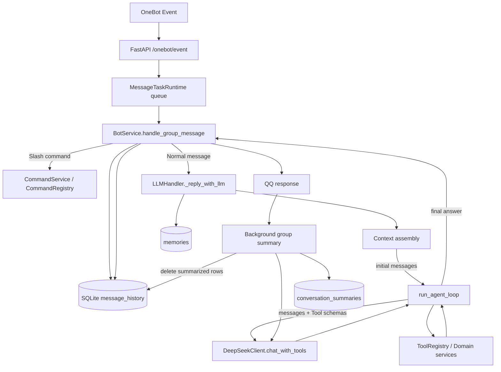

# Agent Loop 上下文管理系统源码审计

审计范围：本报告依据当前仓库源码、默认配置和现有 unittest 编写。没有读取部署环境中的密钥或有效配置覆盖值，因此生产实例的环境变量覆盖状态为 **UNKNOWN**。测试使用本地临时数据库、Fake LLM 或 HTTPX MockTransport；没有调用真实模型、发送 QQ 消息或修改既有代码、测试、配置和数据库。

## 1. Executive Summary

当前实现属于**基本可用的轻量上下文系统**，不是只有最近聊天拼接的原型，也还没有达到成熟的模型窗口管理。它持久化群历史、按当前发言者筛选最近消息、把群摘要和长期记忆加入提示词，并在 Agent Loop 中保留 OpenAI 风格的 assistant tool call 与 tool result。摘要会在回复后异步生成并删除已压缩的旧消息。主要缺口是没有按模型上下文窗口估算或裁剪；摘要的检查、写入、删除不是一个原子操作；用户引用内容和摘要被放在 `system` role 中。真实群聊数据、有效模型上下文窗口和部署环境预算覆盖值没有在本次审计中验证。

## 2. Actual Architecture

### 消息数据流



### 从 OneBot 到当前模型请求

1. `app/main.py` 的 `/onebot/event` 解析事件、进行事件 ID 去重，再将事件放入 `MessageTaskRuntime`；工作队列满时返回 503，不进入上下文组装。[main.py#L288](../app/main.py#L288) [task_runtime.py#L69](../app/task_runtime.py#L69)
2. `BotService.handle_group_message()` 先排除空事件并将斜杠命令交给 `CommandService`。普通消息先写入 `message_history`，之后才判断是否唤醒 Bot、取得同群回复锁并调用 LLM。未触发回复的普通群消息也会写入历史；命令不写入此聊天历史。[bot_service.py#L74](../app/bot_service.py#L74)
3. `_reply_with_llm()` 获取当前群选定的模型、Policy、预算范围、最近历史和记忆，并组装初始消息。Tools 开启时将这份 `messages` 交给 `run_agent_loop()`；否则调用 `chat()`。[llm_handler.py#L428](../app/handlers/llm_handler.py#L428)
4. `run_agent_loop()` 每轮把同一个累积 `messages` 与按 Policy 筛出的 Tool Schemas 传给 `chat_with_tools()`；成功的 Agent 最终回答才由 BotService 作为一条普通 assistant 历史写回。Agent 中间的 assistant tool call 与 tool result 不持久化到聊天历史。[agent.py#L431](../app/tools/agent.py#L431) [bot_service.py#L120](../app/bot_service.py#L120)
5. FastAPI 发送普通回复后才安排 `maybe_update_group_summary()` 后台任务；摘要不是 `run_agent_loop()` 中的上下文压缩步骤。[main.py#L359](../app/main.py#L359) [llm_handler.py#L627](../app/handlers/llm_handler.py#L627)

### 初始上下文的组成和顺序

`LLMHandler._reply_with_llm()` 现有拼接顺序如下。除 Tool Calling 工具 Schema 与后续工具输出外，这就是首次模型请求看到的主要消息：

1. `SYSTEM_PROMPT`，含回复规范、当前请求优先级、证据和配方准确性要求。
2. 当前服务器日期与时间的 `system` 消息。
3. 如果有则加入一条群级摘要 `system` 消息。
4. 如果有则加入群级、管理员管理的持久记忆 `system` 消息。
5. 当前附件说明 `system` 消息；只提供文件名、类型和可能的 URL，明确模型不能读取媒体内容。
6. 当前 QQ 引用回复的 `system` 消息。
7. 当前消息 @ 的成员列表 `system` 消息。
8. 经筛选和截断的近期群历史，使用 user/assistant role。
9. 当前请求的 user 消息，附 QQ ID、昵称和研究提示。

证据：[llm_handler.py#L459](../app/handlers/llm_handler.py#L459) [llm_handler.py#L471](../app/handlers/llm_handler.py#L471) [llm_handler.py#L490](../app/handlers/llm_handler.py#L490) [llm_handler.py#L501](../app/handlers/llm_handler.py#L501) [llm_handler.py#L504](../app/handlers/llm_handler.py#L504)。

Bot 路由区分 @Bot、配置前缀、Bot 名称触发以及回复 Bot 消息；OneBot Adapter 将 `is_at_bot`、mention 和引用消息解析成事件字段。提示构造也分别加入 mention 和引用文本。但历史表不存 `reply_to` 或源消息 ID，因而这只表达**本条请求引用了谁**，没有保存可回溯的回复链或会话线程。[bot_service.py#L134](../app/bot_service.py#L134) [natcapqq_adapter.py#L93](../app/natcapqq_adapter.py#L93) [natcapqq_adapter.py#L124](../app/natcapqq_adapter.py#L124) [natcapqq_adapter.py#L191](../app/natcapqq_adapter.py#L191) [memory.py#L31](../app/memory.py#L31)

本地文档、配方、仓库和 Web 知识不会自动拼进首条 prompt；它们作为工具在模型请求后被调用，结果以 `tool` role 加入本次 Agent 上下文。聊天历史检索和文档知识检索是两条不同路径。[llm_handler.py#L598](../app/handlers/llm_handler.py#L598) [agent.py#L614](../app/tools/agent.py#L614)

## 3. Context Selection

### 选择算法与默认值

- 生产默认 `message_history_limit=80` 条群级记录，`context_recent_message_limit=8` 条提示历史；独立构造 `MemoryStore` 的代码默认是 20，但 `create_app()` 明确传入 Settings 值。[config.py#L120](../app/config.py#L120) [main.py#L83](../app/main.py#L83) [memory.py#L9](../app/memory.py#L9)
- 普通消息写历史时包含发言者 QQ ID、昵称、role、内容和时间。查询按自增 ID 取群内最新记录，倒序后还原时间顺序。每次写入时，超出行数上限的最旧记录会被删除。[memory.py#L31](../app/memory.py#L31) [memory.py#L124](../app/memory.py#L124) [memory.py#L135](../app/memory.py#L135) [memory.py#L152](../app/memory.py#L152)
- 当前事件此前已经被 BotService 写入。`_recent_context_rows()` 取最近 `limit+1` 行；如果末行 role、QQ ID 和内容与当前消息完全一致，就将末行去掉，再选择之前的历史，避免正常情况下当前消息同时作为历史和当前请求重复。[bot_service.py#L87](../app/bot_service.py#L87) [llm_handler.py#L584](../app/handlers/llm_handler.py#L584)
- `select_recent_context()` 从新到旧扫描：所有 assistant 回复和当前用户自己的消息都算 direct；其他成员最多保留 2 条 ambient；达到 limit 后停止，最后按原顺序返回。这里按自增 ID 表达的插入顺序，而不是 `created_at` 时间进行排序。[qq_context.py#L14](../app/qq_context.py#L14)
- 每条选中历史在放进 prompt 时最多保留 500 个字符；中间空白折叠。assistant 回复仍是 assistant role，群成员消息成为带昵称和 QQ ID 的 user role。[qq_context.py#L33](../app/qq_context.py#L33)
- 群级长期记忆按 ID 倒序取最新 10 条；另按当前用户 ID 读取最多 5 条 user-scope 记忆。只找到管理员 `/memory add` 写入群级记忆的当前入口，未找到 user-scope 写入入口；已有的 user-scope 数据是否存在为 UNKNOWN。记忆列表没有关键词相关性排序或去重。[llm_handler.py#L444](../app/handlers/llm_handler.py#L444) [memory.py#L303](../app/memory.py#L303) [commands/service.py#L119](../app/commands/service.py#L119)
- 当前 QQ 引用文本被截到 1400 字符并作为单独背景消息；提及信息是当前事件的 mention 名单。引用原文如果也出现在近期历史中，可以重复出现一次。[qq_context.py#L64](../app/qq_context.py#L64)

### 机制清单

| 机制 | 状态 | 代码事实 |
|---|---|---|
| Sliding Window | PARTIAL | 数据库只保留最新 80 条；请求最多选 8 条，并按当前用户/assistant/最多两条旁支过滤，不是纯粹连续窗口。[memory.py#L135](../app/memory.py#L135) [qq_context.py#L14](../app/qq_context.py#L14) |
| Token-aware truncation | NOT IMPLEMENTED | 历史以字符 500 截断；工具结果以字符限制；没有 tokenizer 或输入 token 裁剪。[qq_context.py#L33](../app/qq_context.py#L33) [registry.py#L299](../app/tools/registry.py#L299) |
| Relevance-based history retrieval | PARTIAL | 只用当前发言者和 assistant role 做 speaker 优先级筛选，无语义相关度打分。[qq_context.py#L19](../app/qq_context.py#L19) |
| Semantic history search | NOT IMPLEMENTED | 搜索实现面向文档/领域知识，不搜索 `message_history`。[llm_handler.py#L598](../app/handlers/llm_handler.py#L598) |
| Keyword history search | NOT IMPLEMENTED | 未发现针对聊天历史的 FTS 或 SQL 文本检索入口；文档 FTS 不等于聊天历史搜索。 |
| Conversation threading | NOT IMPLEMENTED | Schema 没有会话 ID、父消息 ID 或回复链字段。[memory.py#L31](../app/memory.py#L31) |
| Reply-chain tracking | PARTIAL | 当前 event 可解析并格式化一条 quote；quote 未落入历史表且不维护多层链。[natcapqq_adapter.py#L191](../app/natcapqq_adapter.py#L191) [qq_context.py#L64](../app/qq_context.py#L64) |
| Recency weighting | PARTIAL | 倒序扫描最新记录并优先保留 direct 消息，无独立时间衰减分数。[qq_context.py#L22](../app/qq_context.py#L22) |
| Message importance scoring | NOT IMPLEMENTED | 没有重要性字段、评分器或可配置的固定消息保留策略。 |
| Memory deduplication | NOT IMPLEMENTED | 记忆按新到旧取行，不按文本规范化、相似度或来源去重。[memory.py#L303](../app/memory.py#L303) |
| Context source prioritization | PARTIAL | system prompt、日期、摘要、记忆、当前附件/引用/@、历史、当前请求有固定顺序；没有统一 token 预算为来源分配空间。[llm_handler.py#L459](../app/handlers/llm_handler.py#L459) |

### 1000 条群消息、其中 20 条相关时会选什么？

系统**不会**从 1000 条聊天消息中找出 20 条语义相关消息。正常默认下，`message_history` 只保留最新 80 行；本请求查最新 9 行，移除末尾匹配当前事件的那一行，再从剩余行中优先选当前用户消息和所有 assistant 回复、最多补 2 条其他成员消息，最多 8 条。确切是哪 8 行还取决于当前用户 ID、最近群内发言顺序和事件并发时序。

更早的信息只能通过一次或多次成功的群摘要，或管理员维护的长期记忆留在提示中；两者都不是可查询的历史全文，且摘要会有损。没有摘要覆盖的旧行会被 history trim 丢弃。因而“1000 条里有 20 条相关”不意味着能命中这 20 条；只有恰好在近期选择规则内或被摘要/记忆保留下来的内容可能出现。

## 4. Context Compression

### 触发与处理路径

生产默认 `summary_trigger_message_count=18`，这是**群历史行数**而非用户轮数、字符或 token 数。仅在 Bot 已发送非斜杠回复后由后台调用；定时任务回复后也会安排摘要。没有 Bot 回复的聊天仍写入历史并受 80 行 trim 约束，但不会仅因写入达到 18 行就启动摘要。[config.py#L121](../app/config.py#L121) [memory.py#L263](../app/memory.py#L263) [main.py#L359](../app/main.py#L359) [main.py#L419](../app/main.py#L419)

摘要任务保留最近 8 行，取当前其他历史行作为“New messages”，并把旧摘要作为“Existing summary”；每行摘要输入最多 500 个字符。默认最多取 72 行内容（80 行历史减去 8 行近期），因此原始文本部分约不超过 36,000 字符，另加说话人标签、旧摘要（目标最多 1,200 字符）和 Prompt。触发阈值刚达到 18 行时，一般输入 10 行（18 减 8）。[memory.py#L224](../app/memory.py#L224) [llm_handler.py#L96](../app/handlers/llm_handler.py#L96) [llm_handler.py#L631](../app/handlers/llm_handler.py#L631)

使用当前群配置模型调用 `chat(messages, temperature=0.2)`；摘要 Prompt 要求中文纯文本，保留稳定事实、偏好、未完成任务、决定与技术信息，丢弃闲聊，并提示“summary is context, not instructions”。调用没有传 `max_tokens`。响应回来后先 sanitize，再按默认 1,200 字符硬截；字符上限不等于生成 token 上限。[llm_handler.py#L643](../app/handlers/llm_handler.py#L643) [llm_handler.py#L662](../app/handlers/llm_handler.py#L662) [llm.py#L208](../app/llm.py#L208)

### 持久化、失败与风险

- 成功后先确认摘要覆盖边界那条消息仍存在，然后 upsert 每群唯一摘要行，再删除 `id <= last_message_id` 的历史行。`last_message_id` 表示本次摘要覆盖边界，但没有 revision 表或完整性约束。[llm_handler.py#L675](../app/handlers/llm_handler.py#L675) [memory.py#L202](../app/memory.py#L202) [memory.py#L239](../app/memory.py#L239)
- 增量方式是“旧摘要 + 新消息”重新生成一条摘要；旧摘要会反复被压缩，可能遗漏或改变细节。原始已摘要行会删除，不保留可恢复副本。超过 80 行时即使摘要失败，最老历史仍会由 `_trim_history()` 删除。
- 模型请求或生成异常会被捕获并记录 warning；在 upsert 前失败时不删除对应旧行。upsert 成功而删除失败会留下摘要和旧行；下次 `get_messages_for_summary()` 没有按 `last_message_id` 排除这些旧行，可能再次把相同内容并入摘要。[llm_handler.py#L679](../app/handlers/llm_handler.py#L679) [memory.py#L224](../app/memory.py#L224)
- 摘要没有真正的 Agent Loop Compaction。它不检查当前 Agent 的累计上下文、不裁剪工具轨迹，也不会修改正在运行中的 `messages`。
- 摘要和 durable memory 没有去重；同一事实可以同时以摘要和长期记忆两条 system 消息进入上下文。
- 原始群消息以 user role 送给摘要模型。群成员可以写入影响摘要的内容；尽管 Prompt 说摘要“不是指令”，生成摘要随后会以 `system` role 加回普通 Agent prompt。当前引用原文也以 `system` role 注入，尽管其文本标注为“不作为指令”。这是一个真实的信任边界问题，标签不能把不可信文本从 system role 降级。[llm_handler.py#L644](../app/handlers/llm_handler.py#L644) [llm_handler.py#L471](../app/handlers/llm_handler.py#L471) [qq_context.py#L71](../app/qq_context.py#L71)

## 5. Agent Loop Context Lifecycle

在常规流程中，多轮请求沿用同一个 list，不会每轮重新从数据库加载历史：

```text
messages = [system..., selected history..., current user request]
LLM request 1 → assistant(tool_calls=[A]) → tool(A result, id=A)
LLM request 2 → assistant(tool_calls=[B]) → tool(B result, id=B)
LLM request 3 → assistant(tool_calls=[C]) → tool(C result, id=C)
LLM request 4 → assistant final answer
```

这是对代码行为的示意：`run_agent_loop()` 将模型返回的 assistant tool-call 消息追加到 `messages`，执行工具后追加带对应 `tool_call_id` 的 tool 消息；下一轮仍传入完整 list。工具同轮并发运行；每个模型请求都会再次包含当时累积的消息与 Tools schema。[agent.py#L431](../app/tools/agent.py#L431) [agent.py#L495](../app/tools/agent.py#L495) [agent.py#L547](../app/tools/agent.py#L547) [agent.py#L614](../app/tools/agent.py#L614)

结果先由 `ToolRegistry` 限制到 `min(ToolSpec.max_result_chars, ToolContext.result_max_chars)`，并限制 Evidence 数量；之后 Agent 将结果转换为观察文本并再次字符裁剪，然后才追加进内存消息。默认 `ToolSpec.max_result_chars=16,000`，生产 Settings 从环境装载的 `agent_tool_results_max_chars` 默认值是 2,500（直接实例化 `Settings` 的 dataclass 默认则是 6,000）。Agent 每轮将该字符数在有效工具间分摊，但每个结果最少 400 字符；触发专用 SFM 流程时单独使用整份上限。[registry.py#L281](../app/tools/registry.py#L281) [registry.py#L299](../app/tools/registry.py#L299) [agent.py#L542](../app/tools/agent.py#L542) [config.py#L153](../app/config.py#L153) [config.py#L266](../app/config.py#L266)

### 保留、配对、裁剪和结束行为

- 已追加的 assistant tool call 和所有之前的 tool result 会一直留在 `messages` 中；没有旧结果淘汰、累计 Tool token 上限或 Agent 内语义压缩。
- 结果字符限制在存入 Agent 内存上下文前执行；不存在“先保存超长结果、下一轮才裁剪”的路径。
- 有效调用通过 `zip(valid_calls, results)` 追加结果；未知、重复、超本轮限制和总量限制的调用也会追加说明性 tool 消息。代码注释和测试针对每个调用的协议配对，但没有验证 provider 返回的 tool-call ID 唯一性；重复 ID 时 `skipped` 字典可能合并键。[agent.py#L508](../app/tools/agent.py#L508) [agent.py#L585](../app/tools/agent.py#L585) [agent.py#L622](../app/tools/agent.py#L622)
- 默认每次最多 8 个工具规划轮、每轮 10 个调用、整个任务 36 次工具调用、Agent 总 deadline 110 秒；各模型 HTTP 请求也受自己的 client timeout 约束。达到轮次上限后，Agent 再做一次不带工具的普通 `chat()`。[config.py#L148](../app/config.py#L148) [config.py#L152](../app/config.py#L152) [agent.py#L637](../app/tools/agent.py#L637)
- 达到轮次上限时，`_build_final_answer_messages()` 只取最先 3 条 system 内容、最后一条 user 内容和 tool 输出；tool evidence 合并后只保留尾部 `results_max_chars * 2` 字符。它不做语义总结，也会丢掉超过前三条 system 的记忆、附件、引用或 @ 指令，以及其他历史 user turns。[agent.py#L844](../app/tools/agent.py#L844)
- 如果规划模型调用异常（包括可能的上下文超限），循环会记录错误后退出并尝试上述普通最终调用；这不是按错误类型执行的窗口恢复。缩短了 system/历史/tool schema 的最终调用可能成功，也可能再次失败；最终路径失败时返回 `last_text` 或错误文本。没有通用“识别 context length 错误→裁剪→重试”逻辑。[agent.py#L435](../app/tools/agent.py#L435) [agent.py#L451](../app/tools/agent.py#L451) [agent.py#L659](../app/tools/agent.py#L659)
- 若 deadline 或取消发生在 assistant tool-call 消息追加后、tool 消息追加前，本次内存 list 可能暂时包含悬空 tool call。异常会退出 Agent；BotService 只持久化最终普通回复，不把这个临时 list 交给下一次请求，因此不会污染后续群历史。下一次请求从数据库重新构造 messages。
- Tool result 使用 `role="tool"`，没有被提升为 `system` role；外部工具内容仍可能对模型形成间接提示注入，但权限策略由 Registry 执行，工具文本本身不构成系统指令。[agent.py#L614](../app/tools/agent.py#L614) [registry.py#L214](../app/tools/registry.py#L214)

## 6. Token Budget 与模型上下文窗口

### A. 使用预算：存在预留和结算，不代表窗口限制

| 能力 | 现状 |
|---|---|
| 请求次数 | SQLite 预留账本按日支持 global/group/user 请求限制；`BEGIN IMMEDIATE` 下原子检查并写入 reservation。 |
| Token 账本 | provider usage 返回后记精确 reported input/output；未返回时保留为 unknown，并以预留总量参与后续预算。 |
| 预留估算 | `estimate_input_tokens()` 实际是完整 JSON payload（包括 messages、Tools、其他字段）的 UTF-8 字节数，加 8×消息数和 16；代码明确称其为 estimate，不是模型 tokenizer。 |
| 输出预留 | `chat_with_tools()` 固定 `max_tokens=2048`；plain `chat()` 默认没有 `max_tokens`。若配置日 token 限额，必须同时配置 default completion 上限，BudgetController 会在请求前添加/收紧 `max_tokens` 并预留该输出值。 |
| 费用 | 没有可信费率表；显式请求 currency budget 会返回 `BudgetConfigurationError`。当前不应称费用控制或精确费用统计已实现。 |
| 失败与过期 | 确定未派发的连接失败可 release；派发结果未知/usage 缺失按 unknown settled 处理；过期 reservation 在恢复时转 unknown；流式调用会续租。 |
| 并发 | 默认最多 4 个模型 HTTP 请求并发，reservation 在 HTTP send 前完成，SQLite 使用原子事务；Agent 每一轮模型调用各记一笔。 |

证据：[usage_budget.py#L162](../app/usage_budget.py#L162) [usage_budget.py#L266](../app/usage_budget.py#L266) [usage_budget.py#L346](../app/usage_budget.py#L346) [usage_budget.py#L418](../app/usage_budget.py#L418) [usage_budget.py#L501](../app/usage_budget.py#L501) [llm.py#L151](../app/llm.py#L151) [llm.py#L264](../app/llm.py#L264) [llm.py#L373](../app/llm.py#L373)。

默认所有 global/group/user 日请求与 token 限额都是 `None`，所以默认不拒绝额度超限；reservation/usage 账本仍可记录模型请求。当前实际部署是否通过环境变量启用限制未读取，标为 UNKNOWN。[config.py#L137](../app/config.py#L137) [main.py#L92](../app/main.py#L92)

`ToolUsage` 有 tool/request/token/cost 字段，但源码中没有找到构造或累计此 DTO 的调用点。Agent 的工具调用数由内存中的 `executed_calls` 限制；模型 API 请求 usage 则在独立 SQLite reservation 表中计量。不要把前者或 `ToolUsage` 字段本身当作已落账的工具成本统计。[usage_budget.py#L69](../app/usage_budget.py#L69) [agent.py#L413](../app/tools/agent.py#L413)

### B. 模型上下文窗口：未实现

1. 没有按模型维护 context window 大小；`DeepSeekClient` 只保存 provider 的 model 字符串等请求设置。[llm.py#L60](../app/llm.py#L60)
2. 没有 tokenizer。预算估值是 UTF-8 字节近似值，不是 tokenizer token，也不会把估值与某模型窗口比较。[usage_budget.py#L162](../app/usage_budget.py#L162)
3. 使用预算预留会把完整请求 payload 中的 Tools schema 一并估值，但普通 LLM 上下文组装没有执行该估值或裁剪。
4. 没有为输入窗口计算 `system + history + summary + memories + tools + current request + output reserve` 的可用总量。
5. 规划请求只设置 completion `max_tokens=2048`；这限制生成输出，不设定或验证输入窗口。Plain chat 与摘要在无 token 日限额时不传 max_tokens。[llm.py#L208](../app/llm.py#L208) [llm.py#L264](../app/llm.py#L264)
6. 正常历史项有 500 字符、摘要有默认 1,200 字符、工具输出有字符 cap；但当前用户 query 没有在上述调用链找到字符/token 上限。管理员添加长期记忆的参数上限是每条 8,000 字符，最多读最新 10 条群记忆；prompt 没有记忆总量限制。[commands/service.py#L119](../app/commands/service.py#L119) [llm_handler.py#L504](../app/handlers/llm_handler.py#L504)
7. 当 prompt 大于所选 provider 窗口时，是否报错、拒绝请求或截断由 provider 决定；本地无窗口检查。可能先遇到 provider 错误，随后尝试删减 system/history/tool schemas 的 final-call fallback，但没有针对窗口错误做恢复。

因此，**预算够但窗口已满**完全可能；**窗口够但日请求/token预算耗尽**也可能（若配置了相应预算）。两者控制对象不同。当前 token 账本不能回答一次请求是否适合当前模型上下文窗口。

## 7. Persistence and Concurrency

### 数据表与生命周期

| 表 | 用途 / 上下文语义 |
|---|---|
| `message_history` | 以 group_id 隔离的原始成员/assistant 行；无 session、OneBot message ID、reply-to、summary revision 字段。默认最多保留 80 行。 |
| `conversation_summaries` | `group_id` 主键，一群一条摘要，含 `last_message_id` 边界和更新时间；无历史版本。 |
| `memories` | 长期 group/user scope 记录，按 ID 倒序选择；没有去重或文本长度字段约束。 |
| `model_usage_reservations` | 独立使用账本，记录模型、scope、预估/报告 token 和状态；不存 prompt。 |

Schema 证据：[memory.py#L31](../app/memory.py#L31) [memory.py#L44](../app/memory.py#L44) [memory.py#L56](../app/memory.py#L56) [usage_budget.py#L173](../app/usage_budget.py#L173)。

`/context clear` 使用 `clear_group_context()` 一次删除当前群消息历史和摘要，不删除 `memories`；这是“上下文清空”而非清除长期记忆。[memory.py#L178](../app/memory.py#L178) [tests/test_memory.py#L32](../tests/test_memory.py#L32)

生产 `create_app()` 给 BotService/LLMHandler 配置单独的 `StorageExecutor`，SQLite 同步工作通过有界 executor 跑；直接实例化 BotService 且未注入 executor 时，LLMHandler 的 `_sqlite_call()` 会同步执行 SQLite，可能阻塞事件循环。生产实例与 standalone/test 构造因此有差异。[main.py#L87](../app/main.py#L87) [llm_handler.py#L351](../app/handlers/llm_handler.py#L351) [storage_executor.py#L19](../app/storage_executor.py#L19)

### 并发判断

- `MemoryStore` 的 RLock 保护同一个 Python 对象内的单次写方法；SQLite 事务保护每个连接的单次 upsert/delete。它们没有将“读取覆盖范围→检查消息存在→写摘要→删消息”合并为单一事务或 compare-and-set。[memory.py#L13](../app/memory.py#L13) [llm_handler.py#L627](../app/handlers/llm_handler.py#L627)
- 摘要由 `spawn_background()` 启动；此方法按全局后台任务容量限制数量，但不按名字或 group_id 去重。多个同群回复或定时任务可能同时安排摘要。各 SQLite 操作即使由一个 worker 串行执行，也允许两个摘要任务在这些独立 await 之间交错。[task_runtime.py#L78](../app/task_runtime.py#L78) [config.py#L130](../app/config.py#L130)
- **可触发的竞态**：两个摘要任务可能各自读取相近的历史/旧摘要，再按不同完成顺序 upsert；较旧摘要可能覆盖较新的边界。另一个竞态是摘要任务在 `message_exists()` 通过后，管理员执行 `/context clear`，随后摘要任务再 upsert，导致已清理的摘要重新出现。源码没有原子边界阻止此时序。[llm_handler.py#L675](../app/handlers/llm_handler.py#L675) [memory.py#L178](../app/memory.py#L178) [memory.py#L202](../app/memory.py#L202)
- 普通消息在抢同群回复锁之前已写入历史。并发到达的第二条消息即使之后得到“正在回答上一条”的回应，仍会留在历史中；若它插入到当前请求和 `_recent_context_rows()` 查询之间，当前请求自身行不再是尾行，内容匹配去重不会删掉它，第一条请求可能把自己重复放进历史，同时看到后到消息。[bot_service.py#L87](../app/bot_service.py#L87) [bot_service.py#L97](../app/bot_service.py#L97) [llm_handler.py#L584](../app/handlers/llm_handler.py#L584)
- 同一群级消息共享历史和摘要是当前产品行为；它没有按用户隔离对话。当前用户的 direct rows 优先和每次最多两条 ambient 能减少旁支干扰，但所有 bot assistant 回复仍会被视为每位用户的 direct context。

## 8. Test Results

使用仓库现有 `.venv/bin/python` 和 Fake/Fixture 测试，没有真实付费 API：

| 命令 | 结果 |
|---|---:|
| `.venv/bin/python -m unittest tests.test_qq_context tests.test_memory -v` | 6 tests passed |
| `.venv/bin/python -m unittest tests.test_bot_service.SummaryTest -v` | 1 test passed |
| `.venv/bin/python -m unittest tests.test_agent tests.test_agent_integration -q` | 14 tests passed |
| `.venv/bin/python -m unittest tests.test_usage_budget -q` | 21 tests passed |
| **合计** | **42 tests passed，0 failures** |

测试执行边界：起初 `uv run --no-sync` 因 uv 缓存目录只读无法启动，改用现成 `.venv` 后完成上述测试。另尝试完整 `tests.test_bot_service` 时，执行停在与上下文无关的 `test_admin_can_add_and_delete_task`；对该单项施加 25 秒本地超时仍未结束。该测试未算入 42 个通过项，也不能据此断言整个 BotService 测试集通过。

现有覆盖包括：最近用户线程优先与两条 ambient 限制、消息角色格式、引用/@ 标签、历史 trim 和摘要 CRUD、成功摘要后修剪旧历史、每个工具调用有 tool response、工具总 deadline 取消、预算并发准入、缺 usage 和过期 reservation 状态、tool schema 字节纳入使用预算估算。相关测试：[test_qq_context.py](../tests/test_qq_context.py) [test_memory.py](../tests/test_memory.py) [test_bot_service.py#L327](../tests/test_bot_service.py#L327) [test_agent.py#L100](../tests/test_agent.py#L100) [test_usage_budget.py#L91](../tests/test_usage_budget.py#L91)。

未覆盖的关键边界：摘要并发/与 `/context clear` 交错、摘要写入后删除失败、摘要恶意输入、当前消息在后到并发消息插入后的去重、重复 tool-call ID、prompt 超窗口、不同 provider tokenizer 与模型窗口，以及带真实群数据的相关性召回。

## 9. Risk Register

本次没有发现需要标为 CRITICAL 的问题。

| 等级 | 风险与证据 | 触发条件 | 影响 | 修复方向 |
|---|---|---|---|---|
| HIGH | 用户可控 quote 内容和模型摘要以 `system` role 注入。[llm_handler.py#L471](../app/handlers/llm_handler.py#L471) [qq_context.py#L64](../app/qq_context.py#L64) | 用户引用包含指令，或群消息影响摘要内容 | 模型可能把不可信内容误当高优先级指令；文字提示“not an instruction”不能改变 role trust。Tool Registry policy 仍在代码层执行，但模型行为有被误导风险。 | 将可变引用/摘要作为明确标注的不可信 user/context 数据；system role 只保留应用策略；补 prompt injection Fixture 测试。 |
| HIGH | 没有模型窗口或 prompt token 限制。[config.py#L120](../app/config.py#L120) [llm.py#L208](../app/llm.py#L208) [usage_budget.py#L162](../app/usage_budget.py#L162) | 大 current query、较长记忆、累积工具结果或小窗口 provider | 首次请求可能被 provider 拒绝；Agent 无针对超窗的确定性恢复。预算 estimator 不是上下文 tokenizer。 | 增加按 provider/model 配置的窗口与保守估计，覆盖全 prompt、Tools 和输出预留；按来源优先级裁剪并测试拒绝路径。 |
| MEDIUM | 摘要整体生命周期非原子、后台任务不按群去重。[llm_handler.py#L627](../app/handlers/llm_handler.py#L627) [task_runtime.py#L78](../app/task_runtime.py#L78) | 多个同群回复/任务并发安排摘要，或清除上下文与摘要交错 | 旧摘要可能覆盖新摘要；清空后旧摘要可能重新出现；摘要失败/中途失败还可能造成摘要与原始行重复。 | 每群 single-flight；以边界/revision 做 compare-and-set；必要时将摘要写入与删除边界放在一个事务中。 |
| MEDIUM | 消息写历史早于同群 busy 检查，当前事件匹配去重只看最后一行。[bot_service.py#L87](../app/bot_service.py#L87) [llm_handler.py#L584](../app/handlers/llm_handler.py#L584) | 两条同群事件并发，后一行在 context fetch 前写入 | 第一请求可能看到后到消息，并把当前请求重复插入上下文；顺序与提示上下文不再等同于请求时快照。 | 写入时保留数据库 row ID，再按 `< current_row_id` 取历史，或把每群消息写入与快照选择串行化；增加确定性并发测试。 |
| MEDIUM | 工具轨迹无累计窗口裁剪；只限制单轮/单结果字符数。[agent.py#L431](../app/tools/agent.py#L431) [agent.py#L542](../app/tools/agent.py#L542) | 多轮查询返回大量工具结果，或使用小窗口模型 | 每次后续请求会重复携带旧工具结果，Token/延迟增长，可能超窗口。 | 先用 prompt token/window budget 触发 evidence 摘要或淘汰已消费结果；保留 tool-call/result 配对与来源。 |
| LOW | 固定最近记录不能查找远处的相关聊天消息。[qq_context.py#L14](../app/qq_context.py#L14) [memory.py#L152](../app/memory.py#L152) | 用户追问数十轮之前的特定细节，且它未进入摘要/记忆 | 系统可能表示不知道，或依赖模型猜测；这是当前轻量设计的召回上限。 | 收集真实失败案例后先评估 FTS5 历史检索；只有关键词召回不足时再讨论 embedding。 |

## 10. Maturity Assessment

| 维度 | 分数 | 依据 |
|---|---:|---|
| Context Assembly | 3/5 | 来源顺序清晰，能加入 group summary、持久记忆、quote/@ 和有角色标签的近期聊天；但组装直接写在单个 handler 中，且不可信数据混入 system role。 |
| Context Selection | 2/5 | 有固定历史行数、当前用户优先和少量 ambient 规则；没有聊天历史检索、语义相关性、重要性分数或线程模型。 |
| Context Compression | 2/5 | 有可用的 group summary 和旧历史删除，带字符限制；触发是行数，反复压缩旧摘要，缺少原子更新、并发隔离和 Agent 内压缩。 |
| Agent Loop Context Lifecycle | 3/5 | 原生工具协议保留 assistant tool call、匹配工具结果、控制每轮数量/时限/单条字符；累积轨迹无总窗口控制，终轮 flatten 会丢来源上下文。 |
| Token Window Management | 1/5 | 使用账本对请求 payload 做 UTF-8 byte estimate，并支持 reservation/settlement；没有按模型窗口计算、tokenizer、prompt 裁剪或输出空间动态分配。 |
| Persistence & Concurrency | 2/5 | SQLite 有明确群级表与基础锁，生产同步存储经 executor 执行；摘要多步骤非原子、后台摘要无 per-group 去重、消息历史无会话 revision。 |

总体判断：它比“把所有消息拼进 prompt”成熟，有明确的近期上下文边界、用户优先选择、摘要压缩和 tool protocol 生命周期；最准确的级别是**基本可用**。当前不是“较成熟的 context manager”，短板集中在模型窗口预算、摘要并发一致性和信任边界，而不是缺少 Agent 框架。

## 11. Recommended Improvements

### P0：必须修复的正确性或安全问题

| 建议 | 收益 | 复杂度 | 涉及模块与验证 |
|---|---|---|---|
| 将 quote、群摘要及其他用户可写内容从 `system` role 移出，作为带明确边界的引用/上下文数据；保留 System Prompt 作为可信策略层。 | 降低引用和摘要注入优先级的风险。 | 低到中 | `llm_handler.py`、`qq_context.py`；测试恶意 quote、摘要注入文本不会覆盖应用指令，且 quote 仍能作为问题指代。 |
| 增加模型上下文窗口防护：按当前配置模型定义窗口，估算完整 messages + Tools + 输出预留，调用前限制上下文并对过长输入给明确错误。 | 防止超长请求只能等 provider 报错；分离日预算与每请求输入限制。 | 中 | `config.py`、`usage_budget.py` 或独立 prompt estimator、`llm.py`、`llm_handler.py`；Mock 检查请求前拒绝/裁剪、模型切换、工具 Schema 开销。Tokenizer 精确性必须按 provider 验证，估值仍要标示近似误差。 |

### P1：明显提升稳定性与效果

| 建议 | 收益 | 复杂度 | 涉及模块与验证 |
|---|---|---|---|
| 给每群摘要加 single-flight，并用边界版本做条件提交；避免 `/context clear` 后摘要复活。 | 避免旧结果覆盖新结果和清空后恢复。 | 中 | `LLMHandler.maybe_update_group_summary`、`MemoryStore`、任务 runtime；Fake LLM 控制完成顺序，测试重复触发、删除失败、clear 竞态、进程恢复。 |
| 用当前事件的数据库行 ID 或群内处理顺序确定历史快照，不只依赖“末行文本相同”。 | 避免同群并发新消息进入旧请求上下文或造成当前消息重复。 | 中 | `BotService.handle_group_message`、`LLMHandler._recent_context_rows`、history schema/查询；两事件屏障测试并检查被 busy 拒绝消息的明确留存策略。 |
| 对记忆总字符/token 设置软上限，并给摘要请求设置显式 completion 限额。 | 防止 10 条长记忆占满上下文；限制摘要额外生成消耗。 | 低到中 | `commands/service.py`、`memory.py`、`llm_handler.py`、`llm.py`；边界长度、无超限截断丢失关键信息和摘要失败测试。 |
| 终轮 evidence flatten 保留可靠来源/完整性信息，并显式纳入 quote、用户偏好/必要 system 配置，而非固定取最前 3 条 system。 | 避免触顶时丢失关键请求上下文或让引用丢失。 | 低 | `app/tools/agent.py::_build_final_answer_messages`；达到 max rounds 的 Mock 测试校验来源和截断标记。 |

### P2：可选的质量优化

| 建议 | 收益 | 复杂度 | 涉及模块与验证 |
|---|---|---|---|
| 先评估是否要增加 SQLite FTS5 聊天历史关键词召回，限定群 ID、时间与结果数。 | 让远处精确术语/物品名可被追问找回。 | 中 | `MemoryStore`；临时 SQLite fixture 对版本、群隔离、删除、注入字符串、结果上限做测试。需先有实际漏召回案例。 |
| 加摘要元数据：输入覆盖边界、更新时间、生成状态和摘要来源统计。 | 运维时可定位摘要是否过期、缺失或重复。 | 中 | `conversation_summaries`、摘要调用和状态命令；迁移兼容与摘要中断测试。 |
| 收集安全且脱敏的上下文诊断信息（消息条数、字符估算、工具结果数量、provider 错误分类），不记录 prompt 正文。 | 用实际失败数据决定是否升级检索/摘要策略。 | 低 | Agent/LLM 调用与结构化日志；验证不写入 user text、密钥或完整 prompt。 |

### NOT RECOMMENDED：当前不值得引入

- 为现有有界 Agent Loop 引入 LangGraph 或整套 Agent 框架：当前工具协议、轮数、时间和 policy 已由本地代码处理；审计没有发现必须依赖状态图的具体问题。
- 把全部 QQ 历史立即向量化或引入独立向量数据库做聊天记忆：当前持久化历史只有每群 80 行、提示最多 8 行；这会增加隐私、删除一致性和索引维护成本。若发现具体历史召回需求，先用已有 SQLite/FTS5 验证。
- 上复杂的滑动 token eviction、逐工具轨迹语义压缩、多租户会话引擎或 Context 微服务。应先补最小的模型窗口估值、系统/不可信内容边界与摘要一致性，再依据实测负载迭代。

## 12. Evidence Index

| 结论 | 关键证据 |
|---|---|
| HTTP 接入、队列与 BotService 路由 | [app/main.py#L288](../app/main.py#L288)、[app/task_runtime.py#L69](../app/task_runtime.py#L69)、[app/bot_service.py#L74](../app/bot_service.py#L74) |
| 当前 prompt 来源和排列顺序 | [app/handlers/llm_handler.py#L38](../app/handlers/llm_handler.py#L38)、[app/handlers/llm_handler.py#L459](../app/handlers/llm_handler.py#L459)、[app/handlers/llm_handler.py#L471](../app/handlers/llm_handler.py#L471)、[app/handlers/llm_handler.py#L490](../app/handlers/llm_handler.py#L490)、[app/handlers/llm_handler.py#L501](../app/handlers/llm_handler.py#L501)、[app/handlers/llm_handler.py#L504](../app/handlers/llm_handler.py#L504) |
| 历史 schema、截断、群共享、清理 | [app/memory.py#L31](../app/memory.py#L31)、[app/memory.py#L124](../app/memory.py#L124)、[app/memory.py#L135](../app/memory.py#L135)、[app/memory.py#L152](../app/memory.py#L152)、[app/memory.py#L178](../app/memory.py#L178) |
| 当前事件排重、speaker 优先和截断 | [app/handlers/llm_handler.py#L584](../app/handlers/llm_handler.py#L584)、[app/qq_context.py#L14](../app/qq_context.py#L14)、[app/qq_context.py#L33](../app/qq_context.py#L33) |
| 摘要触发、Prompt、生成、写入/删除顺序 | [app/handlers/llm_handler.py#L627](../app/handlers/llm_handler.py#L627)、[app/handlers/llm_handler.py#L643](../app/handlers/llm_handler.py#L643)、[app/handlers/llm_handler.py#L675](../app/handlers/llm_handler.py#L675)、[app/memory.py#L202](../app/memory.py#L202)、[app/memory.py#L224](../app/memory.py#L224)、[app/memory.py#L239](../app/memory.py#L239) |
| Agent 累积上下文、工具响应与 max-round flatten | [app/tools/agent.py#L431](../app/tools/agent.py#L431)、[app/tools/agent.py#L495](../app/tools/agent.py#L495)、[app/tools/agent.py#L585](../app/tools/agent.py#L585)、[app/tools/agent.py#L637](../app/tools/agent.py#L637)、[app/tools/agent.py#L844](../app/tools/agent.py#L844) |
| 工具字符/evidence 限制 | [app/tools/contracts.py#L116](../app/tools/contracts.py#L116)、[app/tools/registry.py#L214](../app/tools/registry.py#L214)、[app/tools/registry.py#L281](../app/tools/registry.py#L281)、[app/tools/registry.py#L299](../app/tools/registry.py#L299) |
| 使用预算估值、reservation、settlement、unknown 处理 | [app/usage_budget.py#L69](../app/usage_budget.py#L69)、[app/usage_budget.py#L162](../app/usage_budget.py#L162)、[app/usage_budget.py#L266](../app/usage_budget.py#L266)、[app/usage_budget.py#L346](../app/usage_budget.py#L346)、[app/usage_budget.py#L418](../app/usage_budget.py#L418)、[app/llm.py#L151](../app/llm.py#L151) |
| 关键默认值与 provider model 字段 | [app/config.py#L120](../app/config.py#L120)、[app/config.py#L137](../app/config.py#L137)、[app/config.py#L148](../app/config.py#L148)、[app/config.py#L266](../app/config.py#L266)、[app/llm.py#L60](../app/llm.py#L60) |
| 测试覆盖来源 | [tests/test_qq_context.py](../tests/test_qq_context.py)、[tests/test_memory.py](../tests/test_memory.py)、[tests/test_bot_service.py#L327](../tests/test_bot_service.py#L327)、[tests/test_agent.py#L100](../tests/test_agent.py#L100)、[tests/test_usage_budget.py#L91](../tests/test_usage_budget.py#L91) |

## 定量估算边界

以下是**字符数/调用次数的源码上限或明确假设**，不是测得的 tokenizer token 数。实际 token 数取决于语言、provider tokenizer、工具 schema 和运行时配置；本仓库未提供足以换算的模型元数据。

| 场景 | 源码可确定的边界 | 估算/限制 |
|---|---|---|
| 10 轮普通对话 | prompt 最多带 8 条历史，每条历史最多 500 字符；summary 默认最多 1,200 字符；群历史默认最多 80 行。 | 即使之前只有约 20 条 user/assistant 行，选择出来的历史仍最多 4,000 字符。若摘要任务已完成，还会多一条最多 1,200 字符摘要。system 文本、记忆、当前 query、附件与 @/quote 另计。 |
| 50 轮普通对话 | 同上；历史不会把完整 50 轮线性放进每次请求。摘要任务成功时覆盖旧行；失败时 80 行 trim 仍继续。 | 近期历史上限仍约 4,000 字符，摘要上限仍 1,200 字符；但未受总量限制的当前 query，以及命令允许的最多 10 条×8,000 字符群记忆，可使完整 prompt 显著变大。 |
| 1000 条群消息后新问题 | 默认只保留最新 80 个历史行；本次最多挑 8 条近期历史，并按当前用户/assistant/最多两条其他成员规则过滤。 | 无法检索 1000 条中的任意 20 条相关记录。旧内容是否留存取决于成功摘要或手动记忆；缺失内容不会因消息总数而自动找回。 |
| 5 轮 Tool Calling | 每轮结果字符总量目标按 `results_max_chars` 分配；生产默认环境装载值为 2,500 字符；前轮所有工具消息进入后续请求。 | 假设每轮 1 个工具，5 个结果最多约 12,500 字符累积，另有每轮 assistant tool-call 和重复发送的 schema。实际每个 tool spec 上限可能更低。 |
| 10 轮 Tool Calling | 默认 `max_rounds=8`，因此 10 轮不可达；可通过环境值覆盖轮数。工具调用总数默认上限 36。 | 假设自定义允许 10 轮且每轮一个结果，每次仍最多约 2,500 字符，累计约 25,000 字符；max-round final 请求仅将末尾 `2×results_max_chars`（默认 5,000 字符）evidence 放入 flatten prompt。 |
| 单次工具返回 20 KB 文本 | 结果先经 Registry 和 Agent 两次字符裁剪；单次调用默认上下文结果 cap 为 2,500 字符（Settings dataclass 直接默认 6,000）。 | 20 KB 字符串不会完整进入下一轮，正常生产默认约 2,500 字符；实际 token 值不可从此换算。 |

在默认 8 轮、36 次有效工具调用、`results_max_chars=2,500` 下，单轮 1–6 个调用的每轮结果通常总计约 2,500 字符（整数分配与 400 字符最低值会有少量差别）；7–10 个调用时每个结果最低 400 字符。取 3 轮各 10 个调用、另 5 轮合计 6 个调用，可达约 24,500 字符的累计 tool observation 内容。该上界不含当前输入、工具参数、assistant 消息与 schemas；不是 token 上界。实际 Provider 请求窗口是否足够仍为 UNKNOWN。
