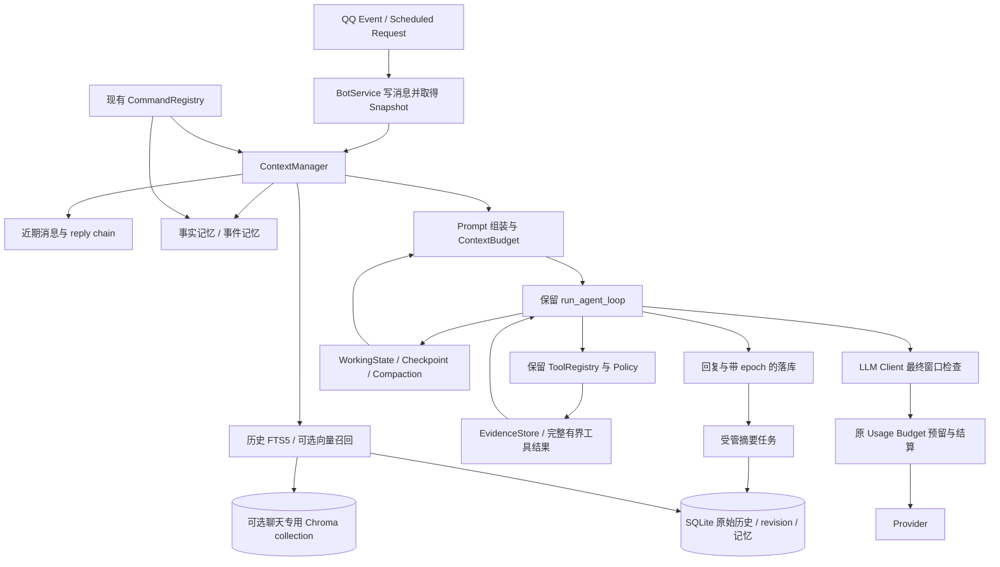

# Context Management V2 设计

日期：2026-10-15。规划源码基线：`63a9da1`；六项边界修订后用于实施，实际代码以当前HEAD为准。状态：Context V2 实施中。配套：[任务](CONTEXT_V2_TASKS.md)、[命令](CONTEXT_V2_COMMANDS.md)。原审计阶段未读取生产配置；当前实施不操作生产数据库、模型、QQ或部署。

## 1. 现状与设计边界

### 1.1 已核对的源码事实

| 事实 | 当前证据 |
|---|---|
| 普通消息先存储，再检查触发和群忙碌；命令走独立 Registry | `app/bot_service.py:74` `handle_group_message()`；`app/commands/service.py:80` `dispatch()` |
| 默认保存群历史 80 行，请求读取最近 9 行，移除末行匹配当前消息后最多选 8 行 | `app/config.py:221`；`app/handlers/llm_handler.py:584` `_recent_context_rows()` |
| 当前用户和所有 assistant 消息优先，其他用户最多两行；每行截至 500 字符 | `app/qq_context.py:14` `select_recent_context()`、`:33` `format_recent_messages()`；实际只扫描 handler 提供的少量候选，不能检索全部历史 |
| 首次消息顺序为策略、日期、摘要、记忆、附件、Quote、mentions、近期历史、当前请求 | `app/handlers/llm_handler.py:428` `_reply_with_llm()`；摘要、记忆和 Quote 当前使用 system role |
| 默认 18 行触发摘要，保留最新 8 行，摘要最多 1200 字符；旧摘要与新行再次交给群所选模型 | `app/config.py:221`–`:224`；`app/handlers/llm_handler.py:627` `maybe_update_group_summary()` |
| 摘要完成后检查边界行存在，再分别写摘要和删除覆盖行；没有 revision 或群 single-flight | `app/memory.py:202`、`:224`、`:239`；handler `:675`；`app/task_runtime.py:78` 只限制后台总容量 |
| 群共享上下文，用户记忆另以全局 user scope 查询；原表无 OneBot ID、reply-to、epoch | `app/memory.py:27` `_initialize()`；handler `:444`；`app/models.py` 的 event 已有这些 QQ 引用字段，但未持久化 |
| Agent 每轮传累积 messages，工具结果先字符裁剪；没有窗口管理或内部 Compaction | `app/tools/agent.py:385` `run_agent_loop()`；`:431`、`:495`、`:614` |
| 触顶 final prompt 只选前三段 system、最后一条 user、工具文本尾部 | `app/tools/agent.py:844` `_build_final_answer_messages()`；可能丢掉 Quote、限制和早期来源 |
| 使用预算支持原子 reservation/settlement，不是模型窗口预算 | `app/usage_budget.py:162` 为 JSON UTF-8 字节估算；`app/llm.py:151` 在 send 前预留；`:248` 工具请求固定输出 2048 |
| plain chat 空输出可重试并扩大 completion；流式有独立派发路径 | `app/llm.py:208` `chat()`、`:301` `chat_stream()`；必须纳入 V2 最终请求检查 |
| SQLite/Chroma 已有有界 executor；文档混合检索已有版本/Evidence/RRF | `app/storage_executor.py`；`app/knowledge/retrieval.py`；`app/vector_rag.py` 延迟加载 embedder，首次使用可能下载模型 |
| 定时任务是另一条任务模型，非 Agent 工作记忆 | `app/bot_service.py` `run_scheduled_task()`；`app/memory.py` `scheduled_tasks`；`app/sfm/workflow.py` 也有独立模型调用 |

现有测试验证近期选择、摘要成功后删行、记忆 CRUD、工具协议、命令权限/确认和 usage 账本，见 `tests/test_qq_context.py`、`test_memory.py`、`test_bot_service.py::SummaryTest`、`test_agent.py`、`test_commands.py`、`test_usage_budget.py`。旧审计的 42 项通过是历史证据，本次未重新运行，不能当作 V2 验收。旧架构文档仍出现已删除的 `command_handler.py` 和静态分发器，按最新 `app/commands/` 与 ToolRegistry 设计，不恢复旧接口。

### 1.2 优先解决的问题

先修复不可信上下文提升 system 信任、请求看到后到消息、摘要竞态和窗口越界，再提升长对话保真与历史召回。80 行之外已删除的数据无法恢复，迁移不得承诺找回。群共享行为继续存在；按用户检索优先级与用户隐私可见性是两件事。

保留 FastAPI、OneBot、LLM Client、自研 Agent、ToolRegistry、SQLite/FTS5/Chroma 和领域服务。没有真实 GTNH 数据和已验证 SFM Parser，V2 不改变这些能力状态。无需 LangGraph、新数据库服务器、图数据库或第二套任务调度系统。

## 2. 目标数据流与模块



建议新增小包 `app/context/`：`contracts.py` 放共享数据类，`budget.py` 放模型配置和估算，`manager.py` 放选择/组装，`summaries.py` 放摘要更新，`history.py` 放召回，`memories.py` 放记忆领域规则，`compaction.py` 放协议块压缩，`working.py` 放任务状态/Evidence。只有需要独立实现与测试时才分文件。持久 SQL 继续由 MemoryStore 或同连接的辅助 repository 执行，避免在多个模块复制 SQL。FTS 聊天表与文档表分离，复用算法与 executor，不将聊天伪装成公共文档。

### 2.1 核心接口草案

```python
@dataclass(frozen=True)
class ContextSnapshot:
    group_id: str
    user_id: str
    request_id: str
    epoch: int
    current_row_id: int
    summary_revision: int
    # actor 可见性由服务构造，不接受模型指定

@dataclass(frozen=True)
class ContextItem:
    key: str                    # history:<row-id> / fact:<id>:<revision>
    kind: str                   # quote/recent/history/fact/episode/evidence
    content: str
    source_refs: tuple[str, ...]
    trust: str                  # 所有动态项均 untrusted
    estimated_tokens: int
    required: bool
    score: float

class ContextManager:
    async def build(self, event, snapshot, model_profile, tool_schemas) -> PreparedContext: ...
    async def stats(self, actor_scope) -> ContextStats: ...
    async def reset(self, actor_scope, expected_epoch) -> ClearResult: ...
    async def purge(self, actor_scope, expected_epoch) -> ClearResult: ...
    async def request_compaction(self, actor_scope) -> SummaryJobStatus: ...

class ContextBudget:
    def estimate(self, messages, tools, profile) -> TokenEstimate: ...
    def fit(self, mandatory, candidates, tools, profile, output_reserve) -> FitResult: ...
    def validate_payload(self, prepared_payload, profile) -> WindowDecision: ...

class HistoryRetriever(Protocol):
    async def search(self, query, snapshot, limit, deadline) -> HistorySearchResult: ...

class MemoryService:
    async def select(self, query, snapshot, token_cap) -> list[MemoryRecord]: ...
    async def search(self, query, actor_scope, kind, limit) -> list[MemoryRecord]: ...
    async def propose(self, candidate, source_snapshot) -> MemoryWriteResult: ...
    async def retract(self, ref, actor_scope) -> bool: ...
```

`PreparedContext` 包含策略、不可变当前请求、候选项、已序列化 messages、TokenEstimate、snapshot、诊断及 WorkingState 初始值；不是向模型暴露的权限对象。`ToolContext`/PolicySnapshot 仍由原入口构造，禁止从 WorkingState/检索文本反序列化权限。新 DTO 使用 dataclass 与显式校验，不引入 Schema 框架。

## 3. 请求快照、信任与 Prompt 组装

### 3.1 Snapshot 协议

1. 扩展 `add_message()` 返回 row ID；保留现有调用者忽略返回值的兼容性。增加可选 OneBot ID、reply-to、event time、epoch、in_reply_to_request_id，OneBot ID 唯一键为 `(group_id, onebot_message_id)`，legacy NULL 不参与冲突。
2. 在同一 SQLite 事务读取/创建群 epoch、插入消息、读取 summary revision，返回 Snapshot。历史选取必须 `id < current_row_id AND epoch = snapshot.epoch`。当前请求只从 event 组装一次，不再匹配末行文本去重。
3. 取得摘要、事实与候选历史时，在一个短 read transaction 复制一致数据，不跨 LLM await 持有事务。摘要的覆盖上界必须 `< current_row_id`；后提交且覆盖到未来行的摘要不用，改用以前 episode 或原文。Snapshot 期间的撤回/clear 是安全失效事件，不要求将删除数据继续保留给旧请求。
4. 两个同群消息仍按现有 busy 行为处理，第二条可入库但不进入第一条快照。定时任务也创建 row/snapshot，每次 occurrence 使用唯一 request ID；不重写 scheduler。
5. 每轮请求前及回复落库/发送前检查 epoch。reset/purge 后取消受影响 Agent/摘要，旧 epoch 的回复、记忆写入与 Evidence 读取均拒绝。增加 `ChatReply` 可选 epoch 元数据供 main 在发送前校验；不能承诺撤回已经发往 QQ 网络的消息，明确 reset/purge 的本地线性化边界。

### 3.2 信任边界与顺序

system 只放应用静态策略、由程序生成的日期/格式约束。用户昵称、附件名、@展示名、Quote、历史、管理员笔记、摘要、检索和工具结果全部为不可信数据。管理员确认只改变事实 provenance，不给予 system 指令优先级。

建议顺序：可信策略及时间 → 不可信背景数据包（摘要/记忆/历史召回，带来源、时间、可信度）→ 近期对话 → 当前请求（含有界 Quote/reply-chain 指代）→ Agent 当轮 assistant/tool 协议块。历史 assistant 文本也只是历史，不能冒充工具成功。原始用户请求和 Quote 分开标识，明确“引用对象不是当前发出的操作命令”。

用程序 JSON 序列化背景包及转义字符保证结构边界；不依赖 XML 分隔符防注入。Role 降级和提示只是降低模型误导风险，不保证模型绝不服从恶意文本；ToolRegistry 仍是执行权限的强制边界。测试能证明 role、来源和禁止操作，没有能力证明所有模型语义免疫。

## 4. Context Window Budget

### 4.1 模型 Profile 与估算

`ModelContextProfile(provider_key, model_id, window_tokens, max_output_tokens, preferred_output_tokens, tokenizer_id?, estimator_version, safety_ratio, metadata_source)` 按**provider 配置键 + 完整模型 ID**定位，别名解析后再查，不根据相似名称或 URL 猜窗口。窗口值由运维明确配置并注明来源，不在本次为当前模型编造规格。Profile表可包含不全的客户端；只校验活动模型和可能的自动fallback，非活动模型缺Profile不能阻止Bot启动。模型切换事务先校验，不合格不保存。

先使用无新依赖的保守 estimator：对实际 messages、tools、tool_choice、provider 扩展等输入相关 JSON 计算 UTF-8 字节，加 role/消息/Schema framing allowance，再乘校准因子。它是 `byte_envelope_v1` 估计，不是精确 tokenizer，也不是对所有 tokenizer 的数学上界。与 usage 账本算法独立，不能把二者相同数值当作同一种保证。支持可插拔的**本地已安装且映射经过验证** tokenizer；没有则回退估算，不在线下载，不假定已有 tiktoken。精确 tokenizer 仍需 provider framing 余量。

模式为受控 `off / shadow / enforce`。`off` 不做 V2 估算诊断；`shadow` 估算并记录脱敏诊断，但沿旧路径派发，**不具备窗口防护**；`enforce` 执行窗口准入。enforce 下活动模型无 Profile 即 `WINDOW_UNKNOWN` 并拒绝派发。未启用/非活动模型缺 Profile 不阻塞 Bot 启动；只有活动模型和可能触发的自动 fallback 需要 Profile，fallback 未配置时禁用 fallback 并明确报告。模型切换前验证其 Profile，失败不写群设置。生产启用 enforce 前，所有生产启用的模型及 fallback 都必须有 Profile 并通过启动配置检查。

Profile 来源为 `verified_provider / operator_declared`。运维可明确声明窗口/输出限制，但始终显示 `operator_declared`（未经验证）；不得根据模型名、相似别名或 URL 猜测参数，也不得设通用窗口掩盖缺失。Bot 可在活动 Profile 缺失时继续接收、执行安全命令和报告状态，拒绝 Agent 模型派发。

### 4.2 算法与优先级

定义 `W=window_tokens`，`O=min(首选输出, profile输出上限, usage政策completion上限)`，`S=max(512, ceil(W*0.10))`，`I=W-O-S`。若 provider 另有限制输入窗口，取更小的输入上限。reasoning 也占 completion 时包括在 O，不将 2048 视为所有模型的固定最佳值。

`estimate(messages + tools + framing) <= I` 才准入。每次删减/替换后对完整序列重算，不仅把 ContextItem 的估值相加。优先级如下：

| 优先级 | 内容 | 超限处理 |
|---|---|---|
| 必需 | 可信策略、当前请求完整原文、显式用户约束、活动版本、待完成 tool 协议块 | 不能摘要原文或静默截断；必需项仍放不下则拒绝当前调用 |
| 高 | 当前引用目标、正在使用的精确 Evidence、最近一个完整交互、WorkingState | 引用原文可分页/截断并标识，不能改变请求语义；活动证据放不下则缩小工具查询或返回受限状态 |
| 中 | 与当前请求匹配的事实、事件决策、reply-chain、近期消息 | 按相关性和预算选择；事实不得只保留数值丢掉版本/限定条件 |
| 低 | 低分历史召回、重复摘要、旁支聊天、已完成工具的大段输出 | 先去重，再剔除/归档，保留引用和截断说明 |

建议软配额：近期 24 条（候选 120 条）、召回 12 条/邻域后最多 32 行、记忆总计 2000 估算 tokens、事件摘要总计 2000 估算 tokens，背景总额不超过 I 的 50%；这些是可重分配软上限，不预填空白。当前输入最大 64 KiB UTF-8 作为硬资源闸门，仍须满足窗口；超过时不入完整正文/索引、不派发 API，返回拆分建议，记录拒绝计数，不能悄悄保存截断事实。Quote 单次最多 16 KiB，超限标识节选，窗口仍不足则请求缩小引用。全局事件 body 上限另沿用接入边界。

### 4.3 LLM 集成与错误恢复

调用链：ContextManager 拟合 → Agent 每轮拟合 → LLM client 在 `BudgetController.prepare_payload()` 后对最终 payload 检查 → usage reserve → HTTP。全入口覆盖 plain/tools/stream、摘要、SFM 内部 chat、final synthesis、空输出 retry。`chat_with_tools()` 增加可选 `max_tokens`，保留旧默认调用方式；所有内部重试不得把 completion 扩大到 O 以上。

不把上下文裁剪放进底层 HTTP transport：client 只负责最后验证，handler/Agent 持有来源语义并执行删减。引入脱敏 `ContextLengthError`，仅在 provider status+有界已知 error code 确认超窗时识别，普通 400/超时不自动归类。当前 `_raise_for_status()` 只保留 HTTP 状态，需保留该安全性，同时提取允许的错误码，不输出 body/URL。流式错误读取也有字节上限。

每次用户请求最多一次超窗恢复（全链共用计数），只压缩可选背景并扩大安全余量，不改当前请求/权限/版本，不回退模型，不重新执行已成功工具；剩余 deadline/usage 不够则明确失败。重试是新的 API 请求，照常预留结算；失去 usage 仍记 unknown。工具副作用不在此机制重放。

### 4.4 安全裕量验证

Fake tokenizer 对已知长度序列验证边界，Fake provider 验证 provider-error 有界恢复；这不能证明真实 tokenizer 准确率。本地若有获准 tokenizer，运行中英混合、NBT、JSON、SFM、长路径、tool schema 语料，要求估值+S 不低于该 tokenizer 计数；不达标提高系数并记录配置。上线后只用正常请求已有 usage 统计 estimated/reported 比率、超窗计数，不额外调用付费 API；provider usage 缺失则 UNKNOWN，不校准成精确值。真实 provider 裕量未测前标“估计防护，非精确窗口保证”。

## 5. 历史召回与生命周期

### 5.1 SQLite 是事实来源

拟增加 `context_groups(group_id PK, epoch, summary_revision, summary_covered_id, updated_at)`；扩展 `message_history` 的可空 QQ 字段、`epoch DEFAULT 0`、可见性/撤回状态、原始内容 hash、估算 token 和 request link。旧行 ID/内容保持不变，无法补齐的 QQ/reply 元数据为 NULL。

聊天 FTS 独立 `chat_history_fts`，仅索引允许的原始文本；中文优先验证当前 SQLite 是否支持 trigram，失败时采用应用生成中文 bi-gram/英文术语的预分词列 + unicode61 FTS5，不新增分词包。与 `RagStore._tokenize()` 的英文策略不能直接等同。构造参数化 MATCH，转义运算符，限制查询 512 字符/32 terms，空词回退近期候选，不允许用户执行 FTS 表达式。

插入、编辑、撤回、清理与 SQLite FTS 在同一事务更新；可重建索引记录进度，旧行最多每批 500 条。检索 SQL 首先以群/epoch/可见性及 snapshot 上界限定候选，再取 top K；索引关联回原表再次确认权限、hash、存在性。Chroma 不是删除/权限事实来源。

### 5.2 选择与融合的可执行规则

1. 当前请求保持一次；显式引用向上追踪最多 3 层，限同群和可见行，引用 ID 未知时只使用本次已取得的 Quote，不跨群 `get_msg` 自动找历史。
2. `< current_row_id` 最近 120 行选 24 条候选，当前发言者、明确 reply-chain 优先；assistant 只有关联本用户/链时获得 direct 加分，legacy 无关联时按普通近期消息计分。
3. 从当前请求提取有界检索词，FTS 取 24 条，按 BM25 排序；选中锚点扩展前后各 1 行，仍执行同群、epoch、时间与 ID 上界、可见性校验。
4. 可选 HistoryVectorRetriever 同样取 24 条；独立聊天 collection、embedding version，默认关闭。向量 top K 后只作候选，回 SQLite 校验；不可用返回 `DEGRADED_FTS_ONLY`。不复用 `rag_gen_` 文档 namespace。
5. FTS/向量用 RRF `sum(1/(60+rank))` 融合；再按显式回复、当前用户、recency 作确定性 tie-break，不按模型生成“重要性”自动提权。近期列表单独预留，不用 RRF 抹掉当前线程。
6. row ID 去重；Quote 和历史同一 OneBot ID 合并定位，重叠邻域合并；内容相同而不同人/时间不直接合并事实。summary/事实若来源行已在当前上下文，抑制重复描述，保留来源链接。
7. 结果按语义组装为带时间和说话人的片段，不混成伪连续对话。预算选取后记录入选/排除原因，不记录正文日志。

默认仅当问题有实词且近期不足，或含回指/旧事实查询时执行 FTS；最多一次检索 + 一次邻域扩展；纯招呼不用 Embedding/LLM。不得用“1000 条历史”测试证明找回已被旧版删除的行。

### 5.3 保存、清除和可选向量一致性

建议新安装原文保留30天/群20,000行/实例512MiB，每批清理最多500行。必须区分事件接收、原文持久化、当前Agent执行和依赖持久化的记忆/Evidence/Checkpoint：达到明确历史容量阈值且 SQLite 仍能安全读写及提交 epoch 时，允许当前请求继续，创建 `persisted=False` 的快照，只带本次请求/显式 Quote，不读旧历史/摘要，不伪造 row ID、source 或已保存状态；需要持久来源或跨轮归档的操作拒绝并返回 `CONTEXT_NOT_PERSISTED`。磁盘满、IO错误、数据库损坏或事务失败不是普通容量降级：若无法确认/推进 epoch 则 Agent 和依赖存储操作 fail closed；不得绕过群、epoch 或权限检查。Chroma 故障可降级 FTS。旧安装迁移不删除数据，未确认留存政策前不启用自动物理删除。摘要成功不删除原文。

命令使用 `/context reset` 与 `/context purge`，均管理员二次确认并绑定actor/group/scope/epoch。reset原子epoch+1，清除活动摘要/任务状态；保留原文但旧epoch不可召回。purge逻辑删除本群原文及派生索引、事件记忆、Evidence和工作状态，保留人工长期事实并把来源标 `source_deleted`。小数据可单事务；大数据先原子epoch+1/tombstone，再每批最多500行物理清理及FTS更新，记录pending状态；SQLite故障fail closed。新消息进入新epoch，不被旧清理任务删除。原 `/context clear` 不保留。

可选向量采用 SQLite outbox：`(operation_id, row_id, hash, embedding_version, epoch, operation, state)`。先 SQLite 提交，再幂等 upsert/delete；写入失败降级 FTS，删除失败记录 pending cleanup。查询只信任 SQLite 允许且 hash 一致的行，故旧向量不能导致已删消息复活。无跨库原子性声明；重启补偿、重建和滞后状态可观测。单次 embedding batch 32、向量查询 1 次、单请求检索 deadline 默认 500ms，模型未在本地时直接停用语义路径，禁止自动下载。

## 6. 结构化记忆

### 6.1 保留 memories 表与稳定 ID

为 `memories` 增加 `kind=fact`、`group_id?`、`owner_user_id?`、`status`、`revision`、`verification`、`confidence?`、`normalized_key?`、`valid_from/to`、`supersedes_id?`。旧内容和 ID 不换表重建；旧记录标 `legacy_note` / `legacy_admin_entry`，不能声称其事实已被验证。旧 user scope 没有群来源，默认隔离为 `legacy_unscoped` 不自动跨群注入；迁移报告数量，管理员经可信来源指定归属后才启用。群记忆可给本群成员用于回答，用户记忆仅 `(group_id, owner_user_id)` 自己可读，无自动跨群迁移。

新增 `memory_sources(memory_id, revision, source_kind, source_id, source_hash, locator, observed_at, verification, source_state)`、`memory_revisions` 保存变更。`verification` 为 `user_asserted / admin_confirmed / tool_observed / inferred_candidate / legacy_unknown`；数值 confidence 可空，只表示模型估计，不能替代 verification。tool_observed 仅能来自程序实际完成的 ToolResult/Evidence，LLM 提交该字符串不能获得状态。

### 6.2 Episodic Memory

`episodes(id, group_id, epoch, start_id, end_id, schema_version, topic, occurred_at, summary, decisions_json, open_questions_json, source_refs_json, revision, state)`；每个决策/问题也关联来源 ID。记录某个不重叠消息区间的讨论，不是一直重写整个群的唯一摘要。visibility 不得高于来源交集，私有用户事实不进入公共群 episode。

### 6.3 写入、冲突、删除

用户 `/memory add` 继续只允许管理员，记录执行者和当前命令来源，作为 `admin_confirmed` 的人工陈述，不表示已经外部工具验证；模型不能调用此入口确认事实。自动抽取只生成候选；可用用户原话作 asserted 背景，但自动长期事实提升默认关闭，不提供模型候选自动转正入口。管理员可显式用 `/memory add` 写入自己确认的陈述，候选不会因此自动升级或合并。规范化 exact hash 做重复检测，同 key 不同值保存并标 conflict；语义相似只建议合并，不直接覆盖。更新追加 revision、保留旧来源，过时事实失效而非删除来源。`/memory delete` 逻辑撤回、撤下索引/注入；`/memory clear` 仍需批量确认。

选取依据可见性、validity、当前问题的 FTS 匹配、明确用户关联、verification、recency；总计默认 2000 估算 tokens，不能只取最新十条。无查询相关性时最多注入少量管理员设定的稳定群偏好，不把全表推入 prompt。事实与 episode 不共享“已验证”标志，后者是派生描述。

原文自然到期时来源标 `expired`，原文显式删除时标 `source_deleted`；记忆不可据此伪称可重读原文。自动候选不再提升；人工确认事实可留存但必须展示来源失效。清理不因记忆合并顺便删除消息。

## 7. 摘要协议

### 7.1 一致性先于智能化

每群单进程 single-flight + SQLite 群 revision CAS。后台任务统一经 MessageTaskRuntime 管理，容量满返回 `DEFERRED`，不创建脱管 task。多进程未来可能重复付费生成，但 CAS 保证至多一个候选提交；本次不宣称跨进程 single-flight。

准备事务取得 `(epoch, base_revision, covered_id, from_id, to_id, input_hash)` 并固定原文区间，保留近期完整消息。LLM await 在事务外；生成后 `BEGIN IMMEDIATE` 检查 epoch/revision/covered_id、来源 hash/撤回状态与区间一致，写入摘要和新的覆盖边界、episode（启用后）、来源索引一并提交。新群消息可追加，不影响旧区间 CAS。条件不满足返回 `STALE`，不覆盖、不立即再调用付费模型；后续自然触发重试。clear 在同一机制 epoch+1，故迟到摘要无法复活。

CV2-03 先保留纯文本摘要与现有触发阈值实现这个协议；CV2-08 再启用结构化 episode 与 Token 触发，避免同时重写存储和抽取。

### 7.2 结构与触发

结构化输出 `SummaryV1(schema_version, topic, facts[], decisions[], open_questions[], source_message_ids[], covered_range)`；每条 item 含 `text/source_ids/verification`。程序限制条数/长度并验证 source ID 必须属于输入；模型不能设置覆盖边界、权限、epoch 或“工具验证成功”。包含原文不支持的断言标 candidate 或拒绝，不能用 Schema 合法冒充事实真实。

建议自动摘要触发：未覆盖旧消息至少 24 行，且估算输入 >=6000 tokens 或旧区间 >=80 行；保留最近 24 行；最小群间隔 5 分钟；每批最多 120 行/8000 估算 tokens；摘要输出最多 1500 tokens 并受 model budget 拟合。阈值不足不为几条闲聊调用模型。信息密度只用可观测代理：reply/thread 数、标识符、明确决定标记；用于排序/统计，不由 LLM 评分单独触发频繁付费请求。数值均为待 Fixture 校准默认。

新 episode 优先摘要原文区间，附少量前后文但明确“覆盖区间以外只作背景”，不再把唯一旧摘要无限滚压。群概览是少数相关 episode/决策的有界派生视图，可从保留的原文和 episode 重建；已过期原文则明确不可无损恢复。模型输出 JSON 无效、预算不足、超时、取消均不推进 covered_id、不删原文；有退避和计数，不自动连续重试。摘要请求同样经过窗口、usage、deadline，数据用 user role。

## 8. Agent Loop Compaction 与 Evidence

### 8.1 集成点

保留 `run_agent_loop()` 的工具执行、去重、Policy、deadline。增加可选 `context_session` 参数；在每轮规划、final 和内部修复请求前调用 `prepare_next_call()`。返回合法 messages/输出上限或受限状态，LLM client 再次验证。旧直接调用测试可由默认本地 session 适配，不能生产绕过窗口。

将 `assistant(tool_calls)` 及其**全部** tool results 视为一个不可拆分 ProtocolBlock。pending block 不压缩；取消/超时不持久化半块；重复 tool_call_id、缺失结果、孤立 tool 拒绝再派发并给安全错误，不能通过随意改 id 破坏 provider extensions。保留 `extra_content` 等 provider 元数据，provider 对隐藏 reasoning/signature 有额外要求时需适配测试，UNKNOWN 时禁用该模型的轨迹重写。

### 8.2 工具结果生命周期

`EvidenceStore.put(ToolResult, tool_call, scope, epoch) -> ResultRef` 在 Agent 转成短观察文本**前**保存Registry实际返回内容和 `completeness: Literal["complete", "partial", "reference_only", "unavailable"]`。若工具/Registry已裁剪、结果状态PARTIAL或字段不完整，标partial；Registry不暴露裁剪前内容就绝不称complete。保留source ID/hash/版本/查询条件/locator。证据归档有硬上限；超限时标partial，不无限放大工具返回。只读领域服务可按原权限、版本、查询条件分段读取并重新核hash，也可能返回reference_only/unavailable。

记录 `result_id/call_id/status/content_hash/content_or_blob/evidence_refs/dataset_version/commit/locator/truncated/expiry`。单任务归档总额 1 MiB、Evidence 条目 128，限额触顶则缩小查询或明确停止，不能静默丢证据。SQLite 原文可重读的结果用于对比；敏感 URL/凭证字段不得入归档。归档是任务级临时数据，默认 TTL 24h，后台清理；clear 立即不可见。

每轮估算超过可用输入的75%只触发压缩评估，不触发额外LLM调用。依次执行：确定性去重、删除低相关可选背景、归档已完成旧ProtocolBlock整块、保留WorkingState和Evidence引用，只有确实需要且deadline、Usage Budget与Context Window Budget足够时才调用LLM提议Checkpoint。语义调用最多两次是硬上限，不是目标次数。始终保留完整tool协议；无法安全拟合就明确报容量错误，不留下孤立assistant tool_calls。

checkpoint 不重写精确配方、NBT、源码或 SFM 程序，只记录它们的 refs/hash/版本及已验证状态；最终答案需要哪些精确事实，就先在预算内重新载入。新增只读 `task_evidence_read(result_id, start, limit)` 工具可作为受限取回入口，Registry 校验同 request/group/user/epoch，不能自由读路径；若原结果不存在，则用原领域服务在固定 commit/版本重查，只读、照常计量，禁止强行执行重复被禁工具或给模型放宽 allowlist。seen_calls 区分“已执行可重读”与“应再次调用”，不允许绕过去重无限循环。

### 8.3 有界语义压缩

确定性归档和 WorkingState 足够时不调用模型；确需提炼旧讨论时最多 2 次 checkpoint 模型调用/任务，每次输出 <=1000 tokens，共用总 deadline 和 usage。模型只提议 checkpoint，程序核对约束/refs/status 后接受；无合法输出时退回确定性状态，不声称压缩成功。总轮数仍默认 8、总工具调用默认 36，新 Evidence read 也计入工具上限，不加隐藏无限循环。

`_build_final_answer_messages()` 改为从 PreparedContext+WorkingState+选中证据构造预算内终答，不再使用前三条 system/尾部字符拼接。终答也不得丢当前约束；没有精确证据则明确不足。trace、原始工具状态和 checkpoint 不直接写入长期记忆；普通聊天历史只写最后回复。

## 9. Task Working Memory 与 Checkpoint

```python
@dataclass(frozen=True)
class WorkingState:
    task_id: str
    group_id: str
    user_id: str
    request_id: str
    epoch: int
    goal: str                    # 来自当前原文，不接受模型覆写
    constraints: tuple[str, ...]  # 原文约束 + 程序限定，保留来源
    pack_version_key: tuple[str, str, str] | None
    completed_steps: tuple[StepRecord, ...]
    pending_steps: tuple[StepRecord, ...]
    evidence_refs: tuple[str, ...]
    assumptions: tuple[str, ...]
    open_questions: tuple[str, ...]
    tool_states: tuple[CallState, ...]
    checkpoint_revision: int
    status: str                  # running/completed/failed/cancelled/interrupted
```

Goal、原文和实际工具状态由程序锁定，模型只提议步骤/假设更新，不能把 failed/not_available 变成 completed/verified。pack key 来自群精确配置快照，任务中改变群配置不偷偷换版本。CV2-04 定义最小容器；CV2-09 用于压缩；CV2-10 才负责完整状态校验和可恢复保存。

`agent_tasks`/`agent_checkpoints` 以 task/group/user/epoch 隔离，checkpoint 写入为本地事务，保存完整原文引用、活动协议边界、Evidence refs/hash、模型标识及状态版本。仅保存已完成 block。默认无跨任务注入；同一请求在 compaction 后可从 checkpoint 恢复，需原权限仍成立并重新验证 epoch。进程重启把 running 标 interrupted，可展示未完成步骤，**不自动再次调用模型或工具**。不新增任意后台续跑；没有 `/task resume`，不将 Agent task 和 scheduled_tasks 合并。TTL 24h，敏感文本只在受控 SQLite，日志只输出计数/ID。

## 10. 配置、迁移与回滚

| 配置组（拟议） | 建议默认 / 边界 |
|---|---|
| `CONTEXT_V2_MODE` | `off/shadow/enforce`；shadow仅诊断且不防护；生产enforce要求全部活动模型/fallback有Profile |
| `MODEL_CONTEXT_PROFILES` | 精确provider/model；来源`verified_provider/operator_declared`；未知活动模型拒绝派发；非活动模型缺Profile不阻塞启动 |
| `CONTEXT_RECENT_MESSAGE_LIMIT` | 从现有 8 向建议 24 迁移，候选 120，最终由预算决定；保留旧 env 名 |
| History retention | 新安装30天/群20000行/512MiB；容量阈值可做非持久化请求降级；SQLite完整性/IO/事务错误fail closed；旧安装确认策略前不自动物理删除 |
| History vector | 默认 off；显式开启且本地模型可用才运行；query 500ms、batch 32 |
| Summary | CV2-03 沿用 18/8/1200；CV2-08 换 24/80/6000、保留 24、间隔 300s、batch120/8000、completion1500 |
| Agent context | 75%仅压缩评估；确定性步骤优先；checkpoint LLM <=2次且须deadline/usage/window均允许；Evidence 1MiB/128项/TTL24h，完整性显式标记 |

当前无独立迁移框架，MemoryStore 用 `_initialize()` 建表和 PRAGMA/ALTER。新增 `context_schema_migrations`（独立于 RagStore 的版本记录），用显式、幂等、短事务增列/建表；大 FTS 回填为有 checkpoint 的独立操作，不能在启动锁住全库数万行。先在生产副本演练，备份由维护者批准后执行；本次不迁移。

存量迁移仅追加/复制派生索引，不删除已有历史、memory、任务、配方或知识索引。旧 summary 保留原文，标 `legacy_unverified`，覆盖缺失来源为 UNKNOWN，不当成完整 episode。旧 ID 不变；legacy 行 epoch=0，缺失 QQ ID 不合成真实 ID。升级后 disable `_trim_history()` 的即时 80 行淘汰与摘要删行路径；这两者必须同一次切换，避免声称保留原文实际继续删除。

回滚优先停用新增召回/结构化抽取/压缩功能、保留 V2 正确性与窗口闸门，不直接运行会重新 trim 的老二进制。新增表不自动 DROP，FTS/向量均可离线重建；clear epoch 不能回退，已确认删除不能通过回滚复活。如必须退版本，维护者在副本验证安全补丁和存储策略后操作，不能承诺无损降级到原算法。

## 11. 可测量验收与不采用的方案

Fake/Fixture：确定性验证 50 轮、200 人群聊行、1000 行历史、8 轮工具；Fixture 中声明预期事实、来源与版本，不能让模型给自己打分。离线指标：当前请求出现一次；快照未来行泄漏为 0；所有模型派发符合估算窗口；孤立工具消息为 0；必需约束保留率 100%；预设旧术语/中文查询 recall@12 >=90%；恶意跨群命中 0；精确配方/源码字节、ID/版本/hash 不被压缩篡改；过期证据不能报 verified。语义近义召回单独报告，不要求 FTS 达到 embedding 效果。

本地集成：临时 SQLite 真实 FTS5、迁移旧 schema、故障和并发屏障；Chroma 用临时实例+Fake embedding，可用本地已安装模型另报告，不强制下载。SQLite 不可用时明确拒绝依赖它的上下文/记忆操作，不假装“空库”；Chroma 故障降级 FTS，不阻止普通 Bot。检索默认 deadline500ms；建议在报告固定硬件上 SQLite 10000 行检索 p95<=200ms、事件循环 heartbeat 最大停顿<=100ms，非跨机器保证，未达标必须报告/调整。

真实数据/模型：GTNH 和真实 SFM Parser 验证继续 NOT AVAILABLE；无需其完成才能交付通用机制。无真实模型调用的本轮验收只能证明机械保真/协议与 Fake 工作流，不能证明真实模型摘要质量或 prompt injection 免疫。真实质量需后续经授权、脱敏样本评估，不增加当前开发阻塞。

不采用：逐消息 LLM 重要性评分、全量无限向量化、跨群 user 全局召回、自动将模型推理记为事实、通用 DAG/自主跨重启付费续跑、依靠关键词过滤“彻底防注入”、只裁工具字符串而不看协议块、为升级上下文替换现有 Agent 框架。

## 12. 审查决策与实施前条件

默认方案已明确，无需逐任务确认。实施前应确认：各启用模型的运维声明窗口/输出上限；老安装原文留存政策及容量；旧 user-scope 记忆的归属处理。建议默认不启用聊天向量、不自动提升长期事实、不开跨重启自动续跑。隐私/成本政策未确认时先交付 Fixture 与 shadow 能力，不启用新的生产历史保留或付费行为。三者可影响上线配置，不阻塞本地开发。
