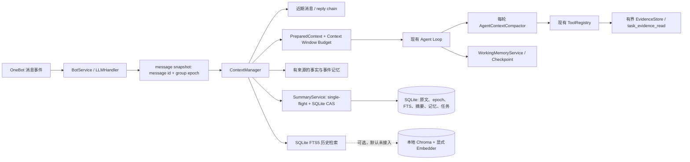

# Context Management V2 实施报告

日期：2026-10-15
实现基线：`63a9da1`；实现时以工作区当前源码为准。
原始实现验收完成时未执行生产部署或 Git 提交；2026-10-17 按用户后续授权完成分组提交和部署。真实 QQ 群消息与真实模型调用仍未执行。

## 1. 实施摘要

CV2-01 至 CV2-12 的本地实现和可执行验收已完成。改动保留现有 FastAPI、OneBot 接入、自研 Agent Loop、OpenAI 兼容客户端、SQLite、FTS5、Chroma 和 Command Registry。新增 ContextManager、Context Window Budget、历史检索、结构化事实与事件记忆、Agent 压缩/Evidence、任务 Working Memory，以及上下文命令和离线评估。

完整 unittest discovery 共 406 项，通过 406 项。测试使用 Fake、Fixture、临时 SQLite、Fake Embedding 和本地临时 Chroma；没有调用真实模型、向真实群发消息或使用生产数据库。服务器部署后的健康、就绪、签名入口和 SQLite 完整性已做 smoke check；真实 QQ 群消息回复、GTNH 文档/配方数据、真实模型长对话质量和 SFM Parser 仍为 `NOT_VERIFIED`。

实现并未获得精确 Tokenizer 计量能力。Context Window Budget 使用明确标注的 UTF-8 JSON 字节启发式估算；默认模式为 `off`。只有维护者按精确 `provider:model` 配置 Profile 并主动启用 `enforce` 后才会在 API 派发前执行窗口限制。Fixture 测试显示历史召回改善，但 V2 prompt 估算大小明显增加，不能据此声称真实模型任务质量提高。

## 2. 架构变化



### 请求上下文

`BotService` 与 `LLMHandler` 在模型请求前以 OneBot message ID 创建请求快照，包含群、用户、当前持久化行、epoch 和消息可见范围。重复 delivery 由唯一消息 ID 去重；无持久化行的容量降级请求不伪造 row ID 或历史来源。`ContextManager` 只在该快照边界内组装当前请求、近期会话、引用链、摘要、可见记忆和可选历史命中，并保留当前用户输入。

动态 Quote、群聊历史、长期记忆、事件摘要、工作状态和工具结果以不可信数据放入 user/tool 内容；可信系统策略仍位于 system 消息。epoch 在组装、模型轮次、工具派发和回复写回等边界复核，reset 后旧请求不能向新会话写入或发送回复。

### 窗口估算与 LLM 派发

`ContextWindowBudget` 精确匹配 provider 与 model，不推测模型名。估算完整 JSON request（包含 tools/schema）大小，按 UTF-8 字节乘 0.40、每消息开销和固定开销计算估算 token，并预留输出 token、安全余量和 payload 字节上限。它同时检查普通请求、Function Calling、流式请求及内部 LLM 请求。遇到结构化的 provider context-length error 时，最多一次收紧输出重试；stream 只在尚未产出内容前重试。

配置支持 `off`、`shadow`、`enforce`。shadow 只记录估算，既不声称保护也不阻止派发；enforce 下缺少活动模型的明确 Profile 会在 HTTP 调用及 Usage Budget reservation 前拒绝。非活动模型缺少 Profile 不阻止 Bot 启动，模型切换先验证 Profile。Profile 可标 `operator_declared`；这是运维声明而非外部规格验证。当前默认 `off`，生产启用 enforce 前需为所有活动模型准备 Profile 并通过运维审核。

估算器不是模型 tokenizer，不是精确 usage 或数学硬保证。未知模型窗口在 `off/shadow` 下仅报告未知/诊断，在 `enforce` 下 fail closed。单条超过配置的最大输入/必需上下文时明确拒绝，不静默截断用户约束。

### 历史、结构化记忆和摘要

SQLite FTS5 按群、epoch、snapshot、可见性过滤历史；CJK bigram 与可用时的 trigram 辅助中文/技术标识符搜索。V2 先融合近期最多 24 条、回复链最多 3 层、FTS 结果及附近消息，按 RRF、来源去重和预算挑选。向量搜索接口可选，默认未在应用中配置；必须显式注入 Chroma collection 与本地 embedding 函数，不自动下载模型。

长期事实保留既有 memory ID 与文本，新增 revision、provenance、verification、visibility、conflict 与 validity。没有来源或未经验证的旧记录标记为 unknown，默认不当成群级已验证事实注入。Episodic Memory 保存结构化主题、决定、未决事项与原文来源引用；Fake 模型 JSON 不等于真实摘要质量认证。

摘要输入固定在消息 snapshot 内，摘要服务每群 single-flight；最终提交通过 SQLite 事务 CAS 校验 epoch、revision 和覆盖边界。摘要结果无效、来源变化、取消、reset 或事务冲突均不推进覆盖位置。摘要不删除原始行。single-flight 是 handler 进程内机制，跨进程正确性由 CAS 保证，但不会保证跨进程只产生一次模型调用。

### Agent 压缩、Evidence 和任务工作状态

现有 Agent Loop 保留；每轮模型调用和最终综合前调用 `AgentContextCompactor`。它先去除低优先级可选上下文，仍超限时整块归档旧 assistant tool-call + tool-result 协议块，并检查 call ID 与 result 一对一。工具结果不会被提升到 system。归档明确结果原文已不可用、精确事实需重新查询。本次不调用额外模型来语义压缩，因此没有模型 checkpoint 的额外费用。

Evidence 有字节、记录数、单记录长度和 TTL 上限，保留 source ID/hash/version/revision/query 条件及 `complete/partial/reference_only/unavailable` 完整性。`task_evidence_read` 通过 ToolRegistry 的权限、参数、超时、并发及调用预算策略，分页当前请求缓存的 Evidence。它不能恢复在 Registry 输出裁剪前从未暴露的内容；部分结果仍标 partial，源码或精确配方应调用原领域工具重新查询。

WorkingState 记录请求目标、约束、已完成/待完成步骤、观察到的工具状态、Evidence 引用、假设与未决项。checkpoint 以群/用户/epoch/request scope 和 revision CAS 写入，并有限制大小和 TTL。启动时未终止任务转成 `interrupted`，不会自动重放模型或工具调用；没有新增通用 DAG/后台 Agent。

## 3. 命令调整

上下文命令由现有 Command Registry 与 Context/Memory 服务实现，移除了 `/context summary` 和旧 `/context clear`。当前命令为：

| 命令 | 权限与行为 |
|---|---|
| `/context show [--summary]` | 查看当前群状态；可选择显示摘要 |
| `/context stats` | 查看消息、索引、摘要和受限统计；真实 payload token usage 未知时明确显示 UNKNOWN |
| `/context compact` | 管理员；复用现有安全摘要流程，无可摘要内容时说明原因 |
| `/context reset` | 管理员二次确认；切换 epoch、清除活动摘要及任务工作态，保留原始历史 |
| `/context purge` | 管理员二次确认；tombstone 后分批删除聊天原文与派生事件/索引，人工长期事实保留但来源引用失效 |
| `/memory search <query> [--kind fact|episode|all] [--limit N]` | 管理员；限定当前群及有权限的用户范围，并返回验证状态和来源引用 |

现有 `/memory list/add/delete/clear` 及非上下文命令继续使用。没有增加 `/task status`。reset/purge 的确认绑定操作、群和 epoch；purge 每批最多物理删除 500 行，可重复确认继续处理。

## 4. 数据迁移与回滚

`MemoryStore` 初始化执行增量、幂等 schema DDL。主要新增或扩展包括：

- `message_history` 的 epoch、可见性、hash、token 估值、撤回/索引元数据；`context_groups` 保存当前 epoch/revision。
- `chat_history_fts`、可选 `chat_history_trigram` 与 `context_index_meta`。
- `conversation_summaries` 的 epoch/revision/覆盖边界。
- `memories` 结构字段、`memory_revisions`、`memory_sources`、`memory_fts`。
- `episodic_memory`、`episode_fts`。
- `history_purge_jobs`、`history_vector_outbox`、`agent_tasks`、`agent_checkpoints`、`context_compaction_metrics`。

既有 memory ID/内容与历史原文不主动删除。初始化可触发有限批次索引回填，并将运行中的旧任务状态改为 interrupted。自动历史 TTL 清理默认关闭；本地实现和测试没有改生产库，部署后的实际迁移情况见第 9 节。

生产启用前的操作要求：在副本上先演练旧 schema 升级、校验 row counts 与 FTS 覆盖、验证备份恢复，然后在维护窗口升级。明确历史留存策略前保持自动 prune 关闭。回滚代码时保留已新增的 SQLite 列与表，不执行反向 DROP；将 Context Budget 留在 `off`、停用可选向量索引即可退回低风险运行。若生产数据迁移后发现 schema 问题，先恢复已验证备份，不要在生产直接执行破坏性清理。

## 5. 测试和离线评估

### 完整回归

实际运行：

```text
timeout 300 .venv/bin/python -m unittest discover -s tests -q
Ran 406 tests in 11.097s
OK
```

另运行历史与记忆 focused 测试（打开 `ResourceWarning`）：20 项通过，无这些 CV2 测试模块的 SQLite 未关闭告警。全量 discovery 中仍有旧 Recipe repository/importer 测试的 SQLite `ResourceWarning`、FastAPI `on_event` 弃用告警，以及 fixture 故意触发的错误路径日志；不影响退出状态。新增上下文测试本身没有外部网络或模型依赖。

### Fixture A/B

固定的 1,000 行人工群聊 Fixture SHA-256：`b3d909b39727a7d0ab1ec23cec60ce0d899ff7e7adb57532a6041b1b15e573ec`。10 个稀有事实散布在历史中，查询要求保留版本 `2.7.3`：

| 指标 | 旧 recent-8 选择 | ContextManager + FTS |
|---|---:|---:|
| 稀有事实召回 | 0/10（recall@8 = 0） | 10/10（recall@12 = 1.0） |
| 当前版本约束文本保留 | 未测作模型质量 | 10/10 |
| 平均输入大小估算 | 477.7 | 9515.5 |
| 额外模型调用 | 0 | 0 |

输入大小由 UTF-8 字节启发式估算，不是实际 tokenizer token。Fixture 说明检索召回改善伴随上下文变大；没有调用模型，因此任务正确率和真实模型回答质量为 `NOT_VERIFIED`。

### 本地检索基准

临时 SQLite 10,000 行、100 次人工 FTS 查询：

| 状态 | p50 | p95 | max |
|---|---:|---:|---:|
| FTS optimize 前 | 1220.299 ms | 1238.076 ms | 1262.979 ms |
| FTS optimize 后 | 175.406 ms | 179.367 ms | 182.521 ms |

环境：Python 3.13.11、SQLite 3.51.0、Linux x86_64、AMD Ryzen 5 7600。该基准为本机合成数据，不是生产 SLA；SQLite FTS optimize 需要写锁，定时维护期间应监控延迟。

### 验收层级

- **Fake/Fixture：通过**，包含 30–50 轮上下文、200 人群聊量级候选、1000 行旧事实召回、摘要竞态/重置、不同窗口、8 轮工具调用、超长结果/Evidence、角色协议、checkpoint 恢复、跨群隔离、注入文本、数据不可用等场景。
- **本地组件集成：通过**，临时 SQLite schema/migration/FTS 与本地临时 Chroma + Fake embedder 测试通过；未下载真实 embedding 模型。
- **真实 GTNH 数据验证：NOT_VERIFIED**，目前没有数据集。
- **真实 SFM Parser 验证：NOT_VERIFIED**，当前未验证可独立运行的 Parser。
- **真实模型质量与 tokenizer 校准：NOT_VERIFIED**，没有付费 API 或真实模型基准。
- **生产服务：已部署并通过健康检查**；生产 schema 初始化已执行，检查细节见第 9 节。没有真实 QQ 消息回归。

## 6. 尚未交付及生产准备

上线前需要维护者处理：

1. 为所有活动模型精确填写 Context Window Profile，核对窗口及最大输出。当前 Context Budget 为 `off`；正式启用 `enforce` 前确认所有活动模型均有 Profile。`operator_declared` 表示运维声明未验证，不能当作模型厂商规格确认。
2. 本次部署前没有创建额外生产数据库备份；启动时已执行非破坏性增量 schema 初始化，`integrity_check` 返回 `ok`。未来任何会清理/删除生产历史或改变保留策略的操作之前，先制作备份并在副本演练迁移、旧 ID/行数、FTS 回填和恢复。
3. 决定历史原文保留时间与 purge 值班流程；自动 TTL 删除默认关闭，不要在没有留存决策时打开。
4. 若需要语义历史检索，先选定可用的本地 Embedding 及版本并显式接入；当前应用默认仅使用 FTS，语义 adapter 的 fake 合约不等于生产向量能力。
5. 获取并验证 GTNH Wiki/任务书/配方数据和字段来源，再进行真实数据完整性验收；GTNH 真实能力未交付。
6. 确认 SFM Parser 版本、许可证、Minecraft 运行时依赖及诊断接口；当前没有真实语法验证。
7. 对摘要调用配置现有 Usage Budget 上限，并监控摘要 provider 调用耗时；测试 Fake 没有验证摘要语义质量。

## 7. 剩余风险

| 严重度 | 风险 | 现状与缓解 |
|---|---|---|
| HIGH | 字节启发式不能准确对应 provider tokenizer，profile 即使存在也可能低估窗口 | enforce 前必须用代表性 payload 与目标 provider 校准安全余量；没有真实校准，不能宣称硬性 Token 窗口保证 |
| HIGH | 当前默认 context mode 为 `off` | 模型窗口不受本地保护；由运维配置 shadow/profile 后逐步启用 enforce |
| MEDIUM | 召回可能显著增加 prompt 大小 | Fixture V2 平均估算约为 V1 的 19.9 倍；应观察真实 payload 估算、响应延迟和 usage，不应只看召回率 |
| MEDIUM | FTS5 optimize 会争用 SQLite 写锁 | 有界周期执行，但生产库规模及锁等待未压测；部署后观测维护窗口的响应时间 |
| MEDIUM | 跨 SQLite/Chroma 无原子事务 | SQLite outbox、hash/epoch 回查和可重试提供最终一致性；Chroma 可暂时滞后，来源以 SQLite 当前记录为准 |
| MEDIUM | Evidence Reader 读取的是已缓存且 Registry 已授权可见的结果 | 若原始工具输出被裁剪，证据保留 partial；精确事实必须重新调用领域服务，不能将缓存页视作原始完整文件 |
| MEDIUM | 摘要 single-flight 不跨多进程 | CAS 防止过期写入，但多 worker 可能重复付出摘要请求；生产多 worker 下应监控重复调用，必要时后续增加数据库租约 |
| MEDIUM | 历史降级/容量策略和自动迁移需要生产验证 | 本次仅临时数据库测试；磁盘/SQLite 错误不会当作普通容量不足吞掉 |
| LOW | 全量旧测试有 SQLite ResourceWarning 和 FastAPI 生命周期弃用告警 | 不影响 406 项通过，属于可独立处理的测试/框架维护事项 |
| BLOCKED_EXTERNAL | 领域数据和 SFM Parser 未提供 | 真实 GTNH 搜索/配方与真实 SFM 语法验证未交付；Fixture 结果不能替代 |

## 8. 回滚和检查点

代码通过四个分组 commit 推送：`5415981`、`7a5b5ae`、`7a3cca9`、`a2a57d3`。未提交原有未跟踪的 `docs/CONTEXT_MANAGEMENT_AUDIT.md`，避免将此前已有文件夹带进本次提交。

代码回滚应逐项 revert 本次提交；不要删除用户原有未跟踪文档。生产已完成增量 schema 初始化，回滚应用代码时保留新增 schema，不执行 DROP 或数据重建。生产 enforce 切换与历史清理均未执行。

## 9. 部署补记（2026-10-17）

- GitHub `main` 和服务器 `/home/anishan/project/bot` 均部署至 `a2a57d3`。服务器通过 `tx` SSH 的 Git bundle fast-forward 更新；因服务器到 GitHub 的 HTTPS 拉取两次中断，未改服务器 Git URL 或凭据。
- `qq-deepseek-bot.service` 重启后为 `active`；`/ready` HTTP 200、`/health` HTTP 200。部署前后服务工作区 clean。
- Context V2 SQLite schema 在启动时初始化。使用只读连接运行 `PRAGMA integrity_check` 返回 `ok`；`message_history` 与 `chat_history_fts` 各 70 行，`memories` 9 行，`episodic_memory` 和 Agent task/checkpoint 表正常存在。没有检查或输出消息正文。
- 自动历史清理配置未启用；本次没有执行 reset、purge、TTL 删除或真实历史内容变更。Context Window Budget 仍使用默认 `off`，未切换生产 enforce。
- 本次部署前没有创建额外生产 SQLite 备份；未改变现有聊天内容。执行生产 purge、TTL 清理或其它破坏性历史维护前，需先明确授权并备份演练。
- 使用生产进程内配置的回调密钥构造了本机无副作用 heartbeat `meta_event`：正确 `X-Signature` 得到 `200 {"status":"ignored"}`，错误签名得到 401。密钥值没有输出。NapCat Docker 部署后日志匹配到的 `Unexpected status code: 401` 数量为 0；期间没有真实 QQ 消息，故不能据此证明 NapCat 对真实群消息完成端到端投递与回复。
- 服务器 GitHub HTTPS 拉取超时后，使用本地已验证的 145 KiB Git bundle 经 SSH 传输，服务器只做 fast-forward；临时 bundle 已在部署检查后清理。
