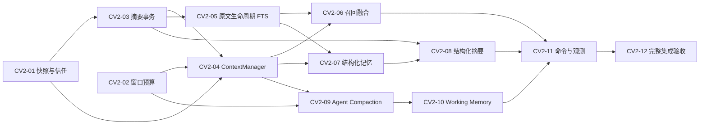

# Context Management V2：实施任务

日期：2026-10-15；源码基线 `63a9da1`。**仅规划，未开始实施。共 12 项，三个迭代，每迭代 4 项。** 契约和默认值以 [DESIGN](CONTEXT_V2_DESIGN.md) 为准；命令以 [COMMANDS](CONTEXT_V2_COMMANDS.md) 为准。本次没有运行下列测试，也没有将此前测试结果作为 V2 验收。

## 1. 交付约束与依赖

所有任务保留现有接入、非命令功能、ToolRegistry 强制权限、配方版本/匹配语义和 SFM 不可用语义。原生 Function Calling 与自研 Agent 保留。每项任务实施时运行目标 unittest 和相关回归；迭代结束运行阶段回归；CV2-12 执行完整验收，不能把测试都拖到最后。

所有新增测试用 Fake/Fixture、临时 SQLite/本地 Chroma，不调用付费 API、不发 QQ、不改生产库、不强制下载模型。迁移只在临时旧 schema 副本测试。各任务有代码检查点；不得自动部署/push或通过回滚恢复不可信 system 注入、历史越权或破坏性 trim。增量迁移不自动反向 DROP，涉及实际生产备份/留存政策时由维护者处理。

图展示直接依赖，表/正文一致；CV2-12 传递覆盖全部任务。迭代是验收组织方式，允许后续任务在前置完成后先做，但不得以并行导致共享文件/表冲突。

| 任务 | 直接依赖 | 可独立验证的主要交付 |
|---|---|---|
| CV2-01 | 无 | Snapshot、epoch、动态上下文角色隔离 |
| CV2-02 | 无 | 模型 Profile、估算、最终 payload 闸门 |
| CV2-03 | CV2-01 | 摘要 CAS/single-flight、保留原文 |
| CV2-04 | CV2-01、CV2-02、CV2-03 | 统一 PreparedContext、预算组装 |
| CV2-05 | CV2-03 | 原文/FTS 事务生命周期与迁移 |
| CV2-06 | CV2-04、CV2-05 | 多路历史选择与可选向量接口 |
| CV2-07 | CV2-04、CV2-05 | memory provenance/revision/可见性 |
| CV2-08 | CV2-03、CV2-07 | episode 和结构化增量摘要 |
| CV2-09 | CV2-02、CV2-04 | 协议完整的 Agent 内部压缩、Evidence |
| CV2-10 | CV2-09 | 完整 WorkingState 校验、Checkpoint |
| CV2-11 | CV2-06、CV2-08、CV2-10 | 小范围命令更新与诊断 |
| CV2-12 | CV2-11 | 全链兼容/质量/性能报告 |

## 2. Iteration 1：正确性与基础

### CV2-01：消息快照与信任边界

- **目标**：当前请求只插入一次；后到消息不能进入旧请求；所有动态文本不再提升到 system。
- **修改范围**：`app/bot_service.py`、`app/handlers/llm_handler.py`、`app/qq_context.py`、`app/memory.py`、`app/models.py`、`app/main.py`；新增 `app/context/contracts.py`/包入口、上下文 schema 版本辅助模块；扩展 `tests/test_qq_context.py`、`test_bot_service.py`、`test_memory.py`、`test_main.py`。
- **依赖**：无。
- **实施边界**：add_message返回row ID，旧调用可忽略；原子记录epoch/当前行/revision及OneBot/reply元数据；同群busy行为保留。增量migration不删行；reset同事务推进epoch。Quote、摘要、记忆、附件名与mentions放动态不可信数据，不进system role；工具权限不从数据包获得。
- **验收标准**：两个事件屏障交错时第一个 prompt 不含第二条；相同文本两次发言保留独立 ID；当前消息恰一次；跨群引用拒绝；clear 使旧 Agent 结果无法落库/进入新发送；静态策略与时间中没有用户字段。已经网络发送的消息不承诺撤回。
- **必要测试**：普通/@/引用/定时请求；恶意昵称、Quote、summary、旧 assistant；clear 与发送前检查；旧 schema 非破坏迁移；现有命令/adapter/dispatcher/busy 回归。
- **完成定义**：以上 Fake/临时库测试通过，记录角色快照、迁移前后原表内容对比与已发送消息边界；不得声称语义注入免疫。
- **回滚**：保留 epoch/信任修复，只停用可选新选取；不回退旧动态 system 注入。新增列保留。

### CV2-02：模型上下文窗口与最终请求校验

- **目标**：建立独立于 usage 账本的 ContextBudget，覆盖每次实际模型派发。
- **修改范围**：新增 `app/context/budget.py` 和 `tests/test_context_budget.py`；修改 `app/config.py`、`app/llm.py`、`app/main.py`；必要时仅在 `app/usage_budget.py` 增加只读 completion-policy accessor；扩展 `tests/test_usage_budget.py`、`test_main.py`，新增 MockTransport client 测试。
- **依赖**：无；独立文件开发可与 CV2-01 并行，main 变更由同一集成者串行合并。
- **实施边界**：精确provider/model Profile；`off/shadow/enforce`；shadow只估算诊断且不防护；enforce未知活动模型拒绝派发。非活动client无Profile不阻塞启动，模型切换前校验；明确运维声明标`operator_declared`，禁止模型名猜窗。无在线tokenizer下载；估算完整payload+输出和安全余量。LLM最终派发前检查，覆盖stream、摘要/SFM及retry，受控错误脱敏。
- **验收标准**：enforce下未知活动模型/必需输入超窗时无HTTP/无reserve；非活动模型无Profile时Bot能启动；切换到缺Profile模型不写群设置；shadow派发但显示诊断/不防护；operator_declared显示未验证；usage/window错误区分，Schema计入，retry不突破输出上限。
- **必要测试**：中文/emoji/NBT/JSON、8k/32k 人工 Profile、单条 64KiB 上限、max_tokens 收紧、stream 错误、usage 缺失/取消；Fake tokenizer 安全余量、MockTransport 断言零派发；现有账本 预留/结算/恢复回归。
- **完成定义**：无新强制依赖，测试通过，估算标识和 UNKNOWN 清晰；Fake 模型窗口不被当作真实模型规格。配置迁移提示列出所有需要人工补齐的 Profile。
- **回滚**：切影子模式仅用于排障且标防护未启用；保留最终闸门代码/账本兼容，不修改既有 reservation 统计。

### CV2-03：摘要一致性、并发及原文保护

- **目标**：先修原有纯文本摘要生命周期，防止覆盖回退/clear 后复活，不提前做结构化抽取。
- **修改范围**：`app/memory.py`、`app/handlers/llm_handler.py`、`app/task_runtime.py`（仅受管任务接入需要时）、`app/main.py`；新增 `app/context/summaries.py`；修改 `tests/test_memory.py`、`test_bot_service.py::SummaryTest`、`test_task_runtime.py`，新增 `tests/test_context_summaries.py`。
- **依赖**：CV2-01。
- **实施边界**：每群single-flight；snapshot与CAS一次事务提交summary/revision/covered ID；LLM事务外；摘要成功不删行，停用旧即时trim。达到容量阈值且SQLite健康、epoch事务仍可提交时允许显式`persisted=False`请求降级；要求持久历史/Evidence/Checkpoint的操作拒绝。存储IO、损坏、事务失败不是容量降级，按类别fail closed。
- **验收标准**：reset/purge或撤回后旧结果STALE；异常、取消、无效输出不推进；原文保留；容量降级不读写旧上下文、不伪造row ID/source，普通Bot请求仍可处理；存储故障fail closed；后台满载DEFERRED，无重启自动付费重跑。
- **必要测试**：两个摘要同群/异群、生成完成乱序、clear 穿插、写提交失败、来源删除、后台容量、取消与重启；重写仅断言“成功即删行”的旧测试，新增保真断言，保留业务断言。
- **完成定义**：临时 SQLite 故障注入和异步屏障通过；明确单进程 single-flight、跨进程只有 CAS；迁移无删除记录。
- **回滚**：可暂停自动摘要；保留原文和 epoch/CAS，不退回旧多步写后删除。

### CV2-04：ContextManager 与统一 Prompt Assembly

- **目标**：从 LLMHandler 抽出真实有职责的选择/组装，接通预算和快照，不改 Agent 调度器。
- **修改范围**：新增 `app/context/manager.py`，扩展 `contracts.py`、`budget.py`；修改 `app/handlers/llm_handler.py`、`app/bot_service.py`、必要的 `app/main.py` 注入；新增 `tests/test_context_manager.py`、调整 handler/Bot 测试。
- **依赖**：CV2-01、CV2-02、CV2-03。
- **实施边界**：PreparedContext、ContextItem、最小WorkingState契约；来源优先级/预算重分配；当前原文与固定约束不可压缩；近期/Quote/reply-chain控制；非Agent chat及摘要使用预算。请求级最多一次超窗恢复，无模型自动回退；`persisted=False`显式穿过组装，不得伪造来源。保留`_reply_with_llm`外部入口，逐步替换私有组装。
- **验收标准**：同一 snapshot 选择确定性；小窗口先去可选背景而不丢用户原文；必需项过大明确拒绝；输出/工具 Schema 都计入；Context Clear 失效检查贯穿模型请求与落库；没有 ContextManager 第二套工具分发。
- **必要测试**：空库、50 轮 Fake 对话、Quote、多用户、budget exceeded、超窗恢复至多一次与 deadline、scheduled request；原模型切换、任务、普通聊天回归。
- **完成定义**：Iteration 1 的快照/角色/摘要竞态/窗口测试全部通过；架构接线可用但历史语义检索/真正 Agent 压缩尚不宣称交付。
- **回滚**：关闭新增背景来源，用 V2 安全组装的近期模式；保留 CV2-01/02/03 的正确性保证。

**Iteration 1 验收门**：现有 Bot 非命令路径兼容、用户消息唯一、窗口前置拒绝可测、摘要无复活且原文保留；完整相关上下文/Bot/Agent/usage/命令 unittest 回归。生产 Profile 和留存政策未确认不阻塞本地门，但不启用生产 enforce/新保留政策。

## 3. Iteration 2：历史与结构化记忆

### CV2-05：历史保存政策、FTS5 与删除一致性

- **目标**：从 80 行短缓存变成受控原文存储，提供群隔离 FTS 检索和幂等回填。
- **修改范围**：`app/memory.py`、`app/config.py`、`app/context/history.py`（新增）、context migration；必要时提取复用 `app/rag.py` 的纯分词 helper，不改文档检索语义；新增 `tests/test_history_retrieval.py`、`test_context_migrations.py`。
- **依赖**：CV2-03。
- **实施边界**：FTS 入库/更新/撤回/清理同事务；中文 trigram 能力检测与 bi-gram 回退；消息 ID/epoch/范围过滤；500 行分批回填；存量不自动触发新物理删除，容量上限明确降级；session reset 与 history purge 域接口先就绪，命令 CV2-11 接入。
- **验收标准**：1000 行人工旧事实可按关键词找到；中文版本/机器名命中；群/用户可见性与快照上界过滤；删除后 FTS 不命中；空库与故障区别；旧数据 ID/内容不变；停止重启回填幂等；session reset 后不能找回旧 epoch。
- **必要测试**：真实临时 SQLite FTS5、旧 schema migration、中文/恶意 MATCH、撤回/TTL/容量、schema 失败回滚、跨群 SQL、source_deleted；不涉及生产库。
- **完成定义**：本地 FTS 集成与既有文档/配方检索回归通过；报告迁移数据量和索引可重建，不宣称 GTNH 已具备。
- **回滚**：停新召回/物理清理；保留原表/FTS 和 epoch，不退回 80 行 trim。

### CV2-06：近期、回复链与历史融合；可选语义路径

- **目标**：相关旧事实可召回，旁支群消息不自动占满 prompt。
- **修改范围**：`app/context/history.py`、`manager.py`、`app/qq_context.py`；新增聊天向量适配模块（需要时）、`app/vector_rag.py` 仅抽取可复用 embedder 接口，不将聊天写入文档 collections；扩展 `tests/test_history_retrieval.py`、`test_context_manager.py`，新增 vector outbox 测试。
- **依赖**：CV2-04、CV2-05。
- **实施边界**：120/24 近期候选、reply-chain 最多3层、FTS24、邻域±1、RRF k60、最终召回12/邻域总32、来源去重和 token fit。HistoryRetriever vector 接口、默认关闭的实现及 SQLite outbox/查询回查必须可用 Fake embedding 测试；本地真实 embedding 模型可用性不是本任务阻塞条件。
- **验收标准**：近期/检索去重、不重复当前请求；预设关键词 recall@12>=90%；200 行群噪声测试指定旧相关行能入选；向量停用/故障不阻塞 FTS；删除失败的旧向量经 SQLite 校验不可见；deadline内降级，不启动下载。
- **必要测试**：1000 行关键词 Fixture、引用他人追问、跨群/跨用户隔离、向量同义 Fake 合约、Chroma 部分失败、过期 hash、outbox 重放、取消和单 lane 有界资源。
- **完成定义**：FTS 融合交付；语义接口/Fake 合约与临时 Chroma+Fake embedding 集成分列；未安装真实模型则真实语义质量标 NOT VERIFIED，不将可选真实模型作为 DoD。
- **回滚**：先关闭向量；必要时回近期+FTS，保留历史原文/索引。

### CV2-07：长期事实 provenance、revision 和记忆检索

- **目标**：扩展现有 memories 保留 ID/内容，提供可追溯事实而非推断即真。
- **修改范围**：`app/memory.py`、migration；新增 `app/context/memories.py`，扩展 contracts/manager；新增 `tests/test_structured_memory.py`、修改 `tests/test_memory.py`。命令注册留 CV2-11。
- **依赖**：CV2-04、CV2-05。
- **实施边界**：memory revisions/sources、verification/validity、FTS 检索和2000估算token上限；group 与 `(group,user)` visibility；legacy user 无归属默认隔离；精确去重、冲突并存和 supersedes。自动候选不自动确认，tool_observed 需程序提供实际 ToolResult。
- **验收标准**：原 memories 行和 ID 不丢；模型伪造 verified 不生效；不同 scope 不互查；冲突保留来源；撤回/失效不再注入，事实更新不删除原消息；来源删除状态准确。
- **必要测试**：人工管理员笔记迁移、恶意候选/来源 ID、同 key 多版本、重复输入、管理员确认与普通声称区别、用户跨群不可见、记忆长度/预算与检索限额。
- **完成定义**：服务接口及迁移测试通过，原记忆 CRUD 业务保留，自动长期事实提升默认关闭；不以 Fake 提取证明真实模型抽取准确。
- **回滚**：停自动候选，保留人工笔记及 visibility；不 DROP 新列或恢复跨群 legacy user 注入。

### CV2-08：结构化 episode 与可恢复摘要

- **目标**：在 CV2-03 CAS 上升级摘要内容，减少反复压旧摘要造成的信息损失。
- **修改范围**：`app/context/summaries.py`、`memories.py`、`manager.py`、`app/memory.py`、`app/config.py`；扩展 migration 和 `tests/test_context_summaries.py`、`test_structured_memory.py`。
- **依赖**：CV2-03、CV2-07。
- **实施边界**：SummaryV1/episodes、源行区间、事实候选、决策/未决问题；Token+行数+间隔触发；批次/生成上限；信息密度仅观测代理；不把每几条消息都摘要。旧 summary 原文以 legacy 标识保留，不补造来源。
- **验收标准**：按原文非重叠区间生成 episode；摘要/episode/covered revision 同事务；无效JSON/来源越界/取消不推进；摘要不自动验证事实；新模型策略不绕窗口/usage；原文保留政策生效。
- **必要测试**：50 轮讨论含决定/撤回/矛盾/未完成问题；两摘要并发、clear CAS、LLM错误、旧summary重复压缩回归、恶意摘要注入；断言来源和原文可回查。
- **完成定义**：Iteration 2 历史/记忆/摘要集成通过，Fixture 中预设决策/来源完整；真实模型摘要保真评估另列 UNKNOWN。
- **回滚**：关闭结构化生成，保留 CAS 与已有 episode，不重启摘要删原文路径。

**Iteration 2 验收门**：1000 行历史可检索；权限隔离、删除索引一致、原文可追溯；长期事实不自动升级；语义路径可关；真实 tokenizer/embedding/GTNH 未验证均单列。

## 4. Iteration 3：Agent 深度上下文与集成

### CV2-09：Agent 内部 Compaction 和 Evidence 生命周期

- **目标**：不重写调度器，在每轮调用前拟合窗口，并保留精确证据和工具协议。
- **修改范围**：`app/tools/agent.py`、`app/handlers/llm_handler.py`；新增 `app/context/compaction.py`、`working.py` 的 EvidenceStore 部分，扩展 contracts；`app/memory.py` 增任务级归档；`app/tools/registry.py`/相关注册点仅增加安全 `task_evidence_read`；新增 `tests/test_agent_compaction.py`，扩展 `test_agent.py`、`test_tool_registry.py`、`test_agent_integration.py`。
- **依赖**：CV2-02、CV2-04。
- **实施边界**：context_session、每轮/终答预算；完整ProtocolBlock移走/恢复；保留extra_content；Evidence completeness=`complete/partial/reference_only/unavailable`并反映Registry已有裁剪；1MiB/128项/TTL24h，超限partial。75%仅触发评估，确定性策略优先；确有必要且整个请求deadline/usage/window均允许时才调用Checkpoint模型，上限2次不是目标。final改来源感知组装；超窗恢复计数全链共享。
- **验收标准**：8轮工具中每个 tool_call_id 恰一结果；不发 pending/孤立/重复 ID 序列；精确配方/源码 hash/版本不变，取回受 request/group/user/epoch权限限制；无法容纳关键证据明确停；超限或失败不把 missing evidence 写成成功。
- **必要测试**：大结果20KiB、多工具同轮、未知/重复ID、8轮Fake、provider extension、final答案、工具超时取消、Evidence过期/归档失败、重读预算计数与恶意工具注入；既有去重/Policy/SFM工作流回归。
- **完成定义**：压缩前后必需约束100%保留、协议异常零派发、Evidence completeness/hash/版本准确；Evidence Read不绕过Registry权限/预算且可用只读领域服务分段读取；Fake测试不宣称语义保真。CV2-10未完成前只支持本次运行状态。
- **回滚**：关闭语义checkpoint，用有界确定性归档；窗口无法拟合就停止，不恢复无限累积。

### CV2-10：Working Memory、Checkpoint 校验与恢复

- **目标**：复杂任务压缩后恢复目标/约束/未完成步骤，隔离普通记忆与定时任务。
- **修改范围**：`app/context/working.py`、`contracts.py`、`compaction.py`、`app/memory.py`、`app/tools/agent.py`；`app/main.py` 生命周期和 `app/bot_service.py` 仅接状态收尾；新增 `tests/test_working_memory.py`、扩展 agent integration。
- **依赖**：CV2-09。
- **实施边界**：Goal/constraints不可覆写，状态建议验证，step/evidence/status transition；agent_tasks/checkpoints原子revision保存；只保存完整协议块；restart标interrupted，不自动调用模型；24h TTL；不实现DAG或跨任务自动resume，scheduled_tasks不改名不迁表。
- **验收标准**：Checkpoint往返恢复同一任务未完成步骤/版本/来源；失败工具不能升级成功；clear/权限变化/过期拒绝恢复；不同任务不带入旧目标；同群任务状态不公开另一用户私有项；重启不产生付费请求。
- **必要测试**：Fake生成→工具→压缩→restore、checkpoint写失败/旧revision、任务取消、pack切换保持原快照、权限撤销、SQLite故障、TTL、定时任务回归。
- **完成定义**：WorkingState机械保真与临时库恢复通过；说明“恢复状态”不等于自动恢复执行，真实长任务质量未验证。
- **回滚**：停checkpoint持久化/恢复，保留运行内WorkingState和Evidence，已有任务标中断而非自动重跑。

### CV2-11：上下文命令调整与可观测性

- **目标**：在现有 CommandRegistry 内增加少量有用入口，暴露真实状态而非重新设计命令系统。
- **修改范围**：`app/commands/service.py`、`app/commands/contracts.py`（确需结果/服务引用时）、`app/context/manager.py`、`working.py`、`memories.py`；必要的 `app/logging_ctx.py`；扩展 `tests/test_commands.py`、新增诊断脱敏测试。
- **依赖**：CV2-06、CV2-08、CV2-10。
- **实施边界**：按COMMANDS注册show --summary、stats、compact、reset、purge、memory search；删除context summary和context clear；确认绑定epoch；复用confirm TTL；不增加task status，不改其他命令。日志不存prompt，只记估值、来源数、revision、耗时、队列、降级状态。
- **验收标准**：动态帮助/权限一致，未知slash不进Agent；普通成员只见安全群统计/摘要；管理员memory search/compact；reset/purge确认令牌不可互换且旧epoch令牌失效；purge后台状态清晰；compact立即返回job状态/重复busy；未知窗口/usage标UNKNOWN。
- **必要测试**：真实Registry/parser+Fake服务、权限矩阵、跨群确认/epoch/过期/重复确认、compact后台满载/同群single-flight、help移除旧子命令、输出脱敏、usage不受context stats替代、原所有非相关命令回归。
- **完成定义**：新命令服务集成和原命令安全测试通过；没有第二个命令分发器，没有Fake Validator成功文案。
- **回滚**：停止新compact入口、隐藏新统计；保留已发布作用域说明和确认安全，不恢复已删除历史或旧权限。

### CV2-12：长对话评估、安全与完整回归

- **目标**：在固定语料和明确测试等级下验收三迭代，建立可重放的V1/V2离线A/B对照。
- **修改范围**：新增 `tests/fixtures/context/` 人工语料、`tests/test_context_v2_integration.py` 与本地离线评估脚本（可新增 `scripts/evaluate_context.py`）；仅修复本次V2缺陷，记录后续报告；不改领域真实数据/生产配置。
- **依赖**：CV2-11（传递依赖全部任务）。
- **验收标准**：下方18场景全部有自动化证据或明确外部验证缺口；1000行关键词Fixture recall@12>=90%，必需约束100%，未来/跨群泄漏0、协议孤立消息0、无付费HTTP/QQ发送。增加隔离的旧V1选择算法与固定Fixture，比较旧事实召回、长对话约束保留、工具协议完整性、平均上下文估值、Compaction次数、额外模型调用、Fake任务判定正确性；报告Fixture版本/hash/种子与原始指标。无真实模型时不声称真实质量提升。完整unittest适用测试通过；性能给固定环境测值，未达目标不能假报通过。缺数据/Parser显式不可用。
- **必要测试**：目标模块 + `uv run --no-sync python -m unittest discover -s tests -v`；不做uv sync/模型下载，若现有uv不可用则用现成 `.venv/bin/python` 并记录原因。阻塞测试用有界诊断，不能删断言/改安全门制造通过。
- **完成定义**：报告通过/失败/跳过数、命令、环境、Fixture版本、性能样本、外部UNKNOWN与可回滚开关；对所有未解决问题明确严重度。此项不包含生产/真实模型质量验收。
- **回滚**：只回滚评估脚本/本次缺陷变更；保留Fixture与失败记录，不删除失败测试。

**Iteration 3 验收门**：8轮工具/Compaction/WorkingState正确，命令兼容边界清晰，所有阶段相关回归和完整测试通过，文档区分已实现、已测、未验证。上线需要独立授权，本规划没有授权部署。

## 5. 18 个必需场景与测量

| # | 场景 | 主责 / 验收观察 |
|---|---|---|
| 1 | 30–50轮连续对话 | 04/08/12；原文保留、当前请求唯一、决定/来源不丢 |
| 2 | 200条多人群聊 | 06/12；当前用户/引用优先、噪声比例受限 |
| 3 | 1000条历史旧事实 | 05/06/12；预设中文/英文检索集recall@12与来源精确率 |
| 4 | 引用他人并追问 | 01/06；reply-chain同群、去重、未提升信任 |
| 5 | 同群两消息并发 | 01；屏障测试snapshot上界与busy |
| 6 | 同群两摘要并发 | 03/08；single-flight和CAS、不双提交 |
| 7 | clear与摘要交错 | 01/03/08/11；旧epoch摘要/回复不可复活 |
| 8 | 不同模型窗口 | 02/04/09；8k/32k人工profile和未知窗口拒绝 |
| 9 | 超长用户输入 | 02/04；原文不截断冒充接受、超窗零派发 |
| 10 | 8轮Tool Calling | 09/10；所有请求估值合规、状态连续 |
| 11 | 工具超长输出 | 09；partial标志、归档限额与可取回证据 |
| 12 | 工具角色与配对 | 09；每个call恰一结果、pending块不压缩 |
| 13 | Compaction事实保真 | 09/12；ID/NBT/行号/版本/hash、约束逐项比较 |
| 14 | Working Memory恢复 | 10；恢复未完成状态但不自动重跑工具 |
| 15 | 跨群/用户隔离 | 05/06/07/10/11；查询、Evidence、命令全入口 |
| 16 | 恶意Quote/Summary/Tool | 01/08/09；role安全和ToolPolicy拒绝，语义免疫不作保证 |
| 17 | SQLite/Chroma部分故障 | 03/05/06/09；SQLite明确失败，Chroma降级、outbox恢复 |
| 18 | 无GTNH/真实SFM Parser | 11/12；status与错误诚实、不借其他版本/Fake冒充 |

等级必须分别记录：**Fake/Fixture合约**（Fake LLM/tokenizer/vector）、**本地集成**（真实临时SQLite FTS5、临时Chroma+Fake embedding）、**真实数据/依赖**（本轮不要求，缺GTNH/Parser标NOT VERIFIED）。真实语义模型未运行不阻塞FTS功能完成；真实provider窗口质量未验不得称精确保证。

建议性能门：固定环境10000行FTS检索p95<=200ms、检索总deadline500ms、event-loop heartbeat最大停顿<=100ms；至少预热后100次样本，记录CPU/内存/SQLite版本/向量开关。CI慢机超标保留结果并诊断，不通过随意增大阈值抹平问题。

## 6. 并行和风险控制

01与02的新增模块可并行，main接线串行；04和05完成前置后可分工但MemoryStore迁移由一人集成。06和07逻辑不同但共享store/manager，须约定文件所有权再并行。09可在04后与Iteration2开发并行，10依赖09；08依赖07，11汇合，12最终验收。没有安全文件隔离时串行，不将“逻辑独立”当成可同时改同表的理由。

三个最高复杂度点：最终payload窗口估算与provider差异；摘要/clear/原文生命周期跨await的一致性；ProtocolBlock压缩、Evidence精确取回与WorkingState保真。每个都有独立故障和边界测试，不以引入框架代替验证。
