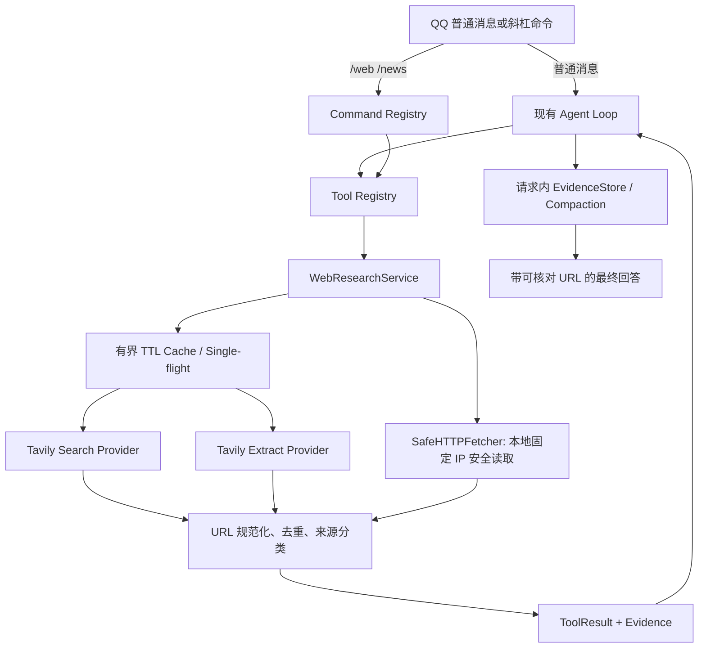

# Web Research 实施记录

## 结果概览

Web Search 和 News Search 已统一接入 `WebResearchService`，默认 Provider 为 Tavily。网页正文读取先检查 URL 是否由本次请求的搜索发现：满足条件时走 Tavily Extract；用户直接给出的 URL、未配置 Tavily 或提取失败时走原有的本地安全读取器。所有搜索和读取仍通过 Tool Registry，Bot 消息接入、Agent Loop、GitHub、天气、配方和其他领域服务没有改写。

本地自动化测试使用 `httpx.MockTransport` 和 Fake Provider；没有调用真实 Tavily API、模型 API、QQ 群或生产服务。因此实现已通过本地契约及回归测试，Tavily 凭据实际连通性仍为 **NOT_VERIFIED**。

## 原实现与移除项

原有外网搜索位于 `app/tools/external.py`：`search_web()` 通过解析 Bing HTML 获取搜索结果，`multi_search()` 并行执行多条查询；新闻由 `search_news()` 先请求 Google News RSS，再尝试 CNR，最后回退到 Bing。网页读取则由 `fetch_web_page()` 走项目已有的 `SafeHTTPFetcher`。

现在 Bing HTML Parser、多查询搜索分发、Google News RSS/CNR 新闻分支和 `feedparser` 依赖已移除。`fetch_web_page()` 与其固定目标 IP 的安全传输仍保留，供直接 URL 和 Tavily Extract 失败时使用。GitHub 仓库/文件检索和天气使用的 `_external_client()` 仍保留，未改用 Tavily。

工具接口统一为 `web_search`、`news_search`、`web_read`。旧 `multi_search`、`fetch_url` 不再注册；当前源码及测试中没有第二套并行 Web Search 分发。`news_search` 作为独立工具保留，是因为它使用明确的 `topic=news` 和较短缓存策略。

## 新架构与调用路径



主要实现位置：

- `app/tools/web_research.py`：`SearchRequest`、`ExtractRequest`、`TavilySearchProvider`、`WebRequestBudget`、`WebResponseCache`、`WebResearchService`、查询增强、结果规范化和 Evidence 生成。
- `app/handlers/llm_handler.py`：构造单例服务，并将服务与单请求预算注入 Agent / 命令的 `ToolContext`。
- `app/tools/agent.py`：原生 Function Calling 工具 Schema 与已有 Agent Loop；模型按需决定是否调用搜索，普通聊天没有强制联网步骤。
- `app/tools/legacy_tools.py`：`_web_search`、`_news_search`、`_web_read` 适配器；仍由同一个 `TOOL_REGISTRY` 做权限和分发。
- `app/commands/service.py`：命令直接 dispatch 到相同工具，不经过 LLM。
- `app/tools/external.py`、`app/tools/url_policy.py`：保留本地安全网页读取及连接目标校验。
- `app/context/compaction.py`、`app/tools/contracts.py`：Evidence Provider、抓取时间、发布时间、完整性和哈希可以随 Agent 结果进入现有 Evidence / Compaction 流程。

`WebResearchService` 是单体内领域服务，不是新 Agent Loop。LLM 在复杂任务中可按工具调用流程执行“搜索、阅读相关页面、再搜索一次”；确定性的 Minecraft 查询增强由 `enhance_minecraft_query()` 实现，不额外调用 LLM。GTNH 网页仅作为带来源的非权威资料，不能代替结构化配方服务。

## Tavily API 参数与响应映射

实现根据 Tavily 当前 API Reference 的 Search 与 Extract 端点核对：

- [Tavily Search API Reference](https://docs.tavily.com/documentation/api-reference/endpoint/search)
- [Tavily Extract API Reference](https://docs.tavily.com/documentation/api-reference/endpoint/extract)

`TavilySearchProvider` 使用现有 HTTPX，以 `Authorization: Bearer …` 调用固定地址 `https://api.tavily.com/search` 或 `/extract`。客户端关闭自动重定向及环境代理继承，TLS 校验保留默认设置；Provider 只接受 API 响应，不接受用户控制的 endpoint。

### Search

默认请求为 `topic=general`、`search_depth=basic`、5 条结果，`include_answer=false`、`include_raw_content=false`、包含发布时间和 usage。支持 `general`/`news`，以及 `basic`、`fast`、`advanced`、`ultra-fast` 深度；应用侧 `max_results` 上限为 10。可选 `time_range`、`start_date`、`end_date`、`include_domains`、`exclude_domains` 进入 Provider 请求和缓存键。日期格式严格为真实日历日期 `YYYY-MM-DD`，日期范围倒置会被拒绝；设置显式日期或相对时间范围时启用 `filter_by_published_date=true`。News 未指定时间参数时默认最近一天；指定明确日期时不再暗加“一天”过滤。

Search 响应中的 `results[].title/url/content/score/published_date` 被规范化为 `WebSearchResult`。`published_date` 与本次 `retrieved_at` 分开保存；Tavily score 仅显示为相关度，不作为可信度。响应 `usage.credits` 为非负整数时记录实际值，字段缺失或无效时记为 UNKNOWN。

Tavily 的 `answer` 不作为证据返回，防止把搜索服务生成的文字直接提升为事实。空结果明确返回 NO_RESULTS，且不生成联网答案。

### Extract 与网页读取

Tavily Extract 使用 `/extract`、`urls`、`extract_depth=basic`、`format=markdown`、有界 `timeout` 和 usage。仅在 URL 来自同一 `ToolContext` 的搜索发现记录、通过公开 URL/DNS 检查且不带敏感查询参数时，URL 才交给远程 Extract。最多 3 个 URL 一批；为相关性传入当前查询和 3 个 chunks，因此结果按 `partial` 对待。超过应用正文限额的内容会被截断并标为 partial。Provider 响应只接受本次请求中明确的 URL；忽略其额外引入的 URL，并处理 `failed_results`。

对搜索结果页的 DNS 检查是传递给 Tavily 之前的应用侧筛选，**不能绑定 Tavily 远程服务的 TCP 连接目标**。远程 Extract 的实际解析与抓取发生在 Tavily 侧，这是独立信任边界；不能把它描述成与 Bot 本地 pinned-IP Fetch 等价。直接用户 URL 不会走 Tavily Extract，而走 `SafeHTTPFetcher`，其 DNS 结果会绑定到实际连接 IP，逐跳校验重定向，禁止代理继承，限制大小、类型和时间，并且不执行 JavaScript。

如果 Extract 返回部分结果，已有页面保留，失败的页面由本地 SafeHTTPFetcher 有界补充；若远程提取全部失败，也只尝试安全本地读取，不虚构正文。直接 URL 的敏感查询凭据不会交给 Tavily；输出 Evidence 中的 URL 进行脱敏。搜索结果若含敏感凭据类查询参数会被丢弃。

### Evidence、引用和可信边界

搜索结果按 `partial` 返回；Extract 在未截断、非 query 分块的情况下才可标为 complete，而当前搜索后阅读使用 query-conditioned chunks，因此仍标为 partial。现有安全本地读取器只提供有界摘要，也标为 partial。Evidence 保存 `source_id`、标题、脱敏或规范化 URL、Provider、检索时间、可用时的发布时间、内容哈希、查询条件和 completeness。精确引用使用真实返回 URL；不从模型文本生成不存在的来源。

网页文本、摘要和搜索片段均为不可信工具数据，不改变 system policy 或 Tool Registry 权限。Evidence 的元数据沿用现有请求内 EvidenceStore / Compaction，不新增 Web 长期证据数据库。正文被裁剪时 completeness 为 partial，哈希指向 Provider 取回的有界正文内容；需要更完整内容时可再次通过允许的 `web_read` 调取。

## 预算、超时、缓存和错误处理

### 上限

- 每个 Agent/命令请求：最多 3 次搜索、3 次 Extract API 尝试、3 次 `web_read` 操作，其中最多 1 次 advanced 搜索。重试也预留调用预算。
- 单次 `web_read` 最多 3 个 URL。
- 每次 Provider 响应最多 2 MiB；Extract 原始正文最多 40,000 字符/页，最终输出按 `WEB_EXTRACT_MAX_CHARS` 截断（默认 12,000，最大 40,000）。
- Tavily 超时默认 12 秒；配置读取范围 3–30 秒，Provider Extract 的 API 参数受 1–60 秒范围约束，并由 Agent deadline/工具 timeout 进一步收紧。
- 每个服务实例最多 60 次联网调用/分钟、最多 4 个同时进行的网络操作。每次 Tavily 尝试以及本地 SafeHTTP 读取都消耗全局槽位；缓存命中不发网络请求。
- 可恢复超时、网络错误和 5xx 最多重试一次；advanced 搜索不重试。429 映射为限流，432/433 映射为额度限制，401/403 映射为鉴权失败。没有可信区分依据时不细分未知 Provider 错误。

每请求预算由共享的 `WebRequestBudget` 用异步锁计数；LLM Handler 为一次 Agent 请求注入同一个实例，命令上下文则首次使用时建立。单次 `web_read` 操作上限也覆盖直接 URL、本地回退路径，避免绕过 Extract 预算。

### Cache

`WebResponseCache` 是进程内 TTL、容量有界的 LRU 缓存，支持同 Key single-flight 和缓存命中/过期统计。最大 256 条、8 MiB。默认 TTL：普通搜索 30 分钟、新闻/日期限定查询 5 分钟、稳定文档 6 小时、版本发布 10 分钟、提取页面 1 小时。搜索 Key 包含 Provider、规范化 query、topic、depth、结果数、时间参数和域名过滤；提取 Key 包含 URL、query、深度和格式。它不跨进程共享、不落 SQLite，重启即失效；多 worker 部署时全局频率和并发限制也是每个进程各自生效。

### 配置

所有配置都可由环境变量提供。`TAVILY_API_KEY` 的 Settings 字段不参与 dataclass repr；代码、测试、文档和日志不写明文密钥。`.env.example` 只保留空变量。当前开发工作区的 `.env` 已被 Git 忽略并限制为当前用户读写，`scripts/run.sh` 会在开发启动时读取它。生产 systemd 服务应在其实际服务环境中另行配置 `TAVILY_API_KEY`；当前未重启、未部署服务。

| 环境变量 | 默认值 | 用途 |
|---|---:|---|
| `TAVILY_API_KEY` | 空 | Tavily 鉴权；缺失不影响 Bot 启动，联网搜索返回 NOT_CONFIGURED |
| `TAVILY_SEARCH_DEPTH` | `basic` | 默认搜索深度 |
| `TAVILY_MAX_RESULTS` | `5` | 默认结果数（1–10） |
| `TAVILY_TIMEOUT_SECONDS` | `12` | Provider timeout |
| `WEB_SEARCH_MAX_CALLS_PER_REQUEST` | `3` | 每请求搜索预算 |
| `WEB_EXTRACT_MAX_CALLS_PER_REQUEST` | `3` | 每请求 Extract 尝试与读取操作上限 |
| `WEB_SEARCH_CACHE_TTL` | `1800` | 通用搜索 TTL 秒数 |
| `WEB_NEWS_CACHE_TTL` | `300` | 新闻及日期过滤 TTL 秒数 |
| `WEB_STABLE_CACHE_TTL` | `21600` | 稳定文档 TTL 秒数 |
| `WEB_RELEASE_CACHE_TTL` | `600` | 版本/Release TTL 秒数 |
| `WEB_EXTRACT_CACHE_TTL` | `3600` | 页面读取 TTL 秒数 |
| `WEB_CACHE_MAX_ENTRIES` | `256` | 缓存条目上限 |
| `WEB_CACHE_MAX_BYTES` | `8388608` | 缓存估算字节上限 |
| `WEB_GLOBAL_CALLS_PER_MINUTE` | `60` | 单服务实例频率上限 |
| `WEB_MAX_CONCURRENT_REQUESTS` | `4` | 单服务实例并发上限 |
| `WEB_EXTRACT_MAX_CHARS` | `12000` | 页面结果正文上限 |

## Tool Registry 与命令

三个 Web 工具通过原生 OpenAI Function Calling 暴露，并继续经过现有 Registry 的参数校验、权限、deadline、Usage Budget 和调用限制：

- `web_search(query, max_results?, search_depth?, time_range?, start_date?, end_date?, include_domains?, exclude_domains?)`：通用搜索；只有用户要求当前信息、内容可能变化或本地知识不足时使用。搜索最多三次，片段标记为 partial。
- `news_search(query, max_results?, time_range?, start_date?, end_date?)`：固定 `topic=news`，未指定时间范围时默认最近一天。
- `web_read(url)`：读取一个明确 URL；搜索发现 URL 使用有界 Tavily Extract，直接 URL 使用 pinned-IP 本地读取器。

现有 GitHub 专用工具继续提供结构化仓库能力，未被 Tavily 替代；weather 继续使用 Open-Meteo 逻辑。

QQ 命令：

```text
/web <query-or-url>
/web search <query> [--depth basic|fast|advanced|ultra-fast]
           [--time-range day|week|month|year]
           [--start-date YYYY-MM-DD] [--end-date YYYY-MM-DD]
           [--max-results 1-10]
/web read <url>
/news [topic] [--time-range day|week|month|year]
       [--start-date YYYY-MM-DD] [--end-date YYYY-MM-DD]
       [--max-results 1-10]
```

`/web` 遇到 URL 时走 `web_read`，否则走 `web_search`；显式子命令由最长命令路径解析，因此 `/web read URL` 不会被当成搜索词。命令直接 dispatch 到 Tool Registry，不经过 LLM。`/status` 显示 `Tavily configured/NOT_CONFIGURED` 以及最近一次 Provider 调用的状态；它不发 API 探测请求，密钥配置本身不代表已经连通。

## 测试与验证状态

### 已运行

- 聚焦回归：
  ` .venv/bin/python -m unittest tests.test_web_research tests.test_tool_compat tests.test_tool_registry tests.test_commands tests.test_agent_compaction tests.test_web_security -q `
  最终运行：**123 tests passed**。
- 全量测试：
  `timeout 300 .venv/bin/python -m unittest discover -s tests -q`
  **444 tests passed**。
- `git diff --check`：通过。

自动化 Provider 测试使用 `httpx.MockTransport`，服务与命令测试使用 Fake Provider/Mock Handler；覆盖 Bearer Header、官方参数字段、响应解析、缺失配置、HTTP 鉴权/限流/额度/服务错误、超时、取消、错误 JSON、响应体上限、提取部分成功、无关 URL 拒绝、敏感 URL 脱敏、SSRF 安全读取回退、日期校验、新闻 topic、GTNH 中英查询增强、来源去重、冲突来源保留、缓存/TTL/single-flight、预算/deadline、Tool Registry 和 QQ 命令路由。

全量测试期间可以看到现有的 FastAPI `on_event`、HTML 正则参数弃用告警以及 SQLite ResourceWarning；这些来自既有模块，与本次 Web Research 测试没有失败关联。测试输出中的模拟失败日志也是既有错误路径测试的预期行为。

### 未验证

- **NOT_VERIFIED：真实 Tavily Search/Extract 连通性、凭据有效性、账户额度和真实 credits。**本次未发真实请求，以避免不必要的 API 使用。状态中的 Provider health 保持 unknown，直到真实成功或失败调用发生。
- **NOT_VERIFIED：生产 systemd 环境是否注入同一 `TAVILY_API_KEY`。**当前仅设置本地开发 `.env`；未部署或重启服务。
- **NOT_VERIFIED：Tavily 服务端提取目标的实际 DNS/TCP 绑定。**该连接在 Tavily 基础设施中，不由 Bot 本地 pinned transport 控制。
- **NOT_VERIFIED：多进程间缓存与全局限流一致性。**目前按单进程实例实现，未引入共享数据库/Redis。
- Provider 和 API schema 会演进；生产启用后应先以一条受控真实请求观察健康状态和 credits，再决定是否开放给所有群成员。

## 变更文件

核心代码：`app/tools/web_research.py`（新增）、`app/config.py`、`app/handlers/llm_handler.py`、`app/tools/agent.py`、`app/tools/contracts.py`、`app/tools/legacy_tools.py`、`app/tools/registry.py`、`app/tools/external.py`、`app/commands/service.py`、`app/context/compaction.py`。

测试与依赖：`tests/test_web_research.py`（新增）、`tests/test_commands.py`、`tests/test_tool_compat.py`、`tests/test_tool_registry.py`、`tests/test_web_security.py`、`tests/test_agent_compaction.py`、`tests/test_bot_service.py`、`pyproject.toml`、`uv.lock`、`.env.example`。

工作区中另有既存未跟踪文件 `docs/CONTEXT_MANAGEMENT_AUDIT.md`；本次没有修改它。
